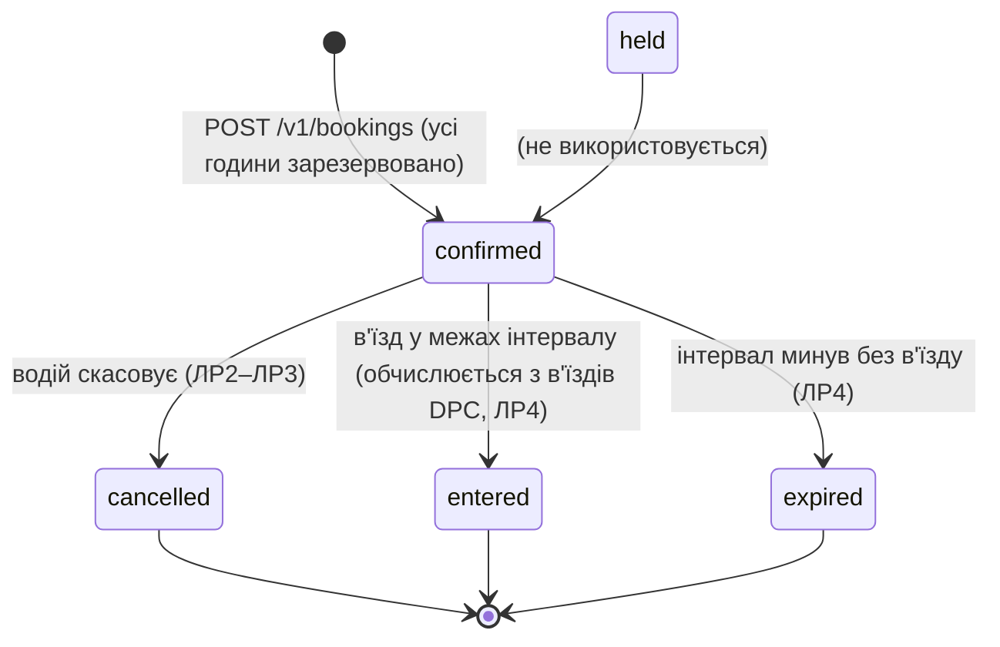

# C09 «Паркінги» – спільний проєкт курсів «Обмін даними у Web-застосунках» і «Розподілені та паралельні обчислення»

> Скелет за `README-template.md` обох курсів (`web/README-template.md`, `dpc/README-template.md`).
> Розділи заповнюються по мірі виконання лабораторних робіт. Опис наданих каркасів –
> [web/KIT-README.md](web/KIT-README.md), [dpc/KIT-README.md](dpc/KIT-README.md).

## 1. Курс і тема

| | |
|---|---|
| Курси | «Обмін даними у Web-застосунках» (Web) і «Розподілені та паралельні обчислення» (DPC) |
| Тема | C09 «Паркінги» (спільна тема Web + DPC) |
| Команда | Вадим, Дарина |

## 2. Проєкт

**Призначення.** Водій бронює місце на рівні паркінгу на кілька годин; шлагбаум відкривається за
бронюванням. Головне навантаження — вечір п'ятниці біля торгового центру: багато одночасних
бронювань останніх місць на години, що перетинаються.

**Ролі.** `user` — водій (бронює, бачить лише свої бронювання); `staff` — оператор паркінгу
(закриває рівень, ЛР3). До ЛР3 користувач передається заголовком `X-User-Id`.

**Сутності (Web).**

| Сутність | Таблиця | Що зберігає |
|---|---|---|
| Паркінг | `garage(id, name, tz)` | назва й часова зона IANA |
| Рівень | `level(id, garage_id, name, spots, closed)` | кількість місць; закритий рівень не приймає нових бронювань |
| Тариф | `tariff(garage_id, minor_per_hour, currency)` | копійок за годину; **власник — DPC** (ЛР6), Web лише читає |
| Година рівня | `level_hour(level_id, hour, free)` | вільні місця в кожну годину |
| Бронювання | `booking(id, user_id, level_id, plate, from_hour, hours, tariff_minor_per_hour, price_minor, currency, status, version, created_at, expires_at)` | головна сутність |
| Користувач | `app_user(id, login, role)` | роль `user` / `staff` |

**Головна операція** — `POST /v1/bookings`: забронювати місце на рівні на `hours` годин з
`from_hour`. Усі години й запис бронювання — в одній транзакції; відповідь 201 — після фіксації.

**Стани й переходи.**



Картка задає `held → confirmed → entered | expired | cancelled`. Окремого маршруту
підтвердження в картці немає, тому бронювання одразу створюється в `confirmed`, а `held` не
використовується; методичка дозволяє адаптувати структуру за збереження інваріантів.
`entered` у базі не зберігається: Web обчислює його з таблиці в'їздів частини DPC.

**Інваріанти.**
1. У кожну годину кількість бронювань на рівні не перевищує кількості місць на ньому:
   `level_hour.free = spots − активні бронювання години`, `CHECK (free >= 0)`.
2. Бронювання кількох годин займає всі години або жодної: усі рядки `level_hour` змінюються в
   транзакції, що створює бронювання; інакше відкат.

**Гроші й час.** Тариф — ціле число копійок за годину (`bigint`) і валюта; неповна година
рахується як повна, тому ціна = тариф × `hours`. Тариф на момент бронювання зберігається в
бронюванні. Моменти — `timestamptz`; назва зони — окремо в `garage.tz`. Інтервал
`[from_hour, from_hour + hours)` у цілих годинах; `from_hour` — початок години. Бронювання
23:00–01:00 займає дві дати. Доба для `GET /v1/levels/{id}/hours?day=` — календарна дата в зоні
паркінгу (у дні переходу на літній/зимовий час 23 або 25 годин).

**Числові параметри (навчальні припущення).**

| Параметр | Значення |
|---|---|
| Паркінги | `mall` «South Mall», `center` «City Centre», зона `Europe/Kyiv` (назви англійською, як в інтерфейсі клієнта) |
| Рівні | `mall-1` 40 місць, `mall-2` 40, `mall-one` 1 (для досліду гонки), `center-1` 20 |
| Тариф | `mall` 3000 коп./год, `center` 4000 коп./год, UAH |
| Тривалість бронювання | 1–24 години |
| Номер авто | текст 2–12 символів |
| Сторінка списку | `limit` 1–50, типово 20 |
| Користувачі | `u-1` user1, `u-2` user2 (user), `s-1` staff1 (staff) |

**Зовнішня система** (ЛР4) — симулятор контролера шлагбаума `POST /open`: 1–3 с, 10 % «немає
зв'язку» (503), одне відкриття на в'їзд. **Запланована зміна ЛР6** — місця із зарядкою для
електромобілів; запити старого клієнта без типу бронюють звичайне місце.

## 3. Архітектура

_Заповнюється в ЛР1–ЛР6._

### Спільний проєкт

_Заповнюється по мірі інтеграції (Web ЛР4, DPC ЛР3, етап 13): межа частин, спільні ідентифікатори
й ключі повтору, контракти взаємодій, обробка повторів і недоступності, наскрізний приклад._
Прийняті рішення щодо межі станів – [docs/decisions.md](docs/decisions.md).

## 4. Структура репозиторію

| Шлях | Призначення |
|---|---|
| `compose.yaml` | один спільний файл Compose для обох частин (профілі – розділ 5) |
| `.env.example` | змінні середовища обох частин (позначки `# Web`, `# DPC`, `# shared`) |
| `checks.yaml` | налаштування засобу перевірки: розділи `web:`, `dpc:`, `scenario:` |
| `migrations/` | спільні міграції PostgreSQL, нумерація `NNN` спільна для Web і DPC |
| `configs/migrate/` | `migrate.sh` – застосування міграцій (сервіс `migrate`) |
| `configs/prometheus/`, `configs/grafana/` | спільні Prometheus і Grafana; дашборди `web.json`, `dpc.json` |
| `web/` | частина Web: каркас курсу та код проєкту (`server/`, `client/`, `configs/`, `tools/`, `docs/`) |
| `dpc/` | частина DPC: каркас курсу та код проєкту (`api/`, `coordinator/`, `spark/`, `configs/`, `tools/`, `docs/`) |
| `web/client/` | клієнт React + TypeScript + Vite (поза Compose) |
| `web/client-kit/` | клієнт-приклад каркаса (довідка) |
| `web/server/tests/` | тести Web проти запущеного стенда (pytest) |
| `web/migrations-examples/`, `dpc/migrations-examples/` | приклади міграцій каркасів (не застосовуються) |
| `joint/` | наскрізний сценарій Web → DPC → Web (`scenario.example.py` – зразок каркаса) |
| `docs/` | рішення, стан проєкту, вимоги обох курсів, плани етапів, звіти |
| `CLAUDE.md` | правила роботи з репозиторієм для агента |

## 5. Збирання й запуск

### Вимоги

- Docker Engine з Docker Compose v2 (перевірено: Docker 28.4.0, Compose v2.39.4, Docker Desktop на Windows 11).
- Пам'ять (`docker stats --no-stream`, без навантаження, 2026-11-04, Docker з 11.7 ГіБ і 4 CPU):
  типовий набір **≈3.9 ГіБ**, разом з `observability` **≈4.8 ГіБ**. Під навантаженням Spark
  (worker `--memory 2g`, executor 1g) і Ray потребують більше. Рекомендовано **≥10 ГБ для Docker**;
  з 4 ГБ (WSL2) Docker Desktop зависав. На Windows ліміт задає `%USERPROFILE%\.wslconfig`
  (`[wsl2] memory=12GB`), після зміни: вийти з Docker Desktop, `wsl --shutdown`, запустити знову.
- Для роботи над однією частиною не потрібно запускати все (див. «Запуск частинами»).
- Вільні порти – таблиця нижче.

### Команди (з кореня репозиторію)

```sh
cp .env.example .env
docker compose config --quiet && echo CONFIG_OK
docker compose build app-a api coordinator-a spark-master external-sim
docker compose up -d
docker compose ps
```

Збирання вказано по одному сервісу на образ: кілька сервісів спільно використовують образи
`project-web`, `project-dpc-api`, `project-dpc-spark`, і паралельне `docker compose build` усіх
сервісів на Docker Desktop падає з `image ... already exists`.

Перевірка:

```sh
curl -fsS http://localhost:8080/health      # Web через nginx
curl -fsS http://localhost:8001/health      # app-a
curl -fsS http://localhost:8002/health      # app-b
curl -fsS http://localhost:8000/health      # DPC api
docker compose exec broker /opt/kafka/bin/kafka-topics.sh --bootstrap-server broker:9092 --list
docker compose run --rm migrate sh /migrate/migrate.sh --list
```

У Git Bash на Windows перед `docker compose exec/run` з абсолютними шляхами задайте `MSYS_NO_PATHCONV=1`.

Зупинка: `docker compose down`; з видаленням томів (база, стан симулятора, дані Spark): `docker compose down -v`.

### Запуск частинами

`docker compose up -d <сервіс>` піднімає сервіс разом із залежностями. Повний набір потрібен
для наскрізного сценарію й захисту.

| Що перевіряємо | Команда | Що підніметься |
|---|---|---|
| Web ЛР1–ЛР3, ЛР5–ЛР6 | `docker compose up -d nginx` | nginx, app-a/b, app-canary, gateway-a/b, postgres, broker |
| Web ЛР4 | `docker compose up -d nginx publisher worker router external-sim` | + outbox, обробник, симулятор |
| DPC ЛР1–ЛР2 | `docker compose up -d api` | api, postgres |
| DPC ЛР3 | `docker compose up -d api ray-worker` | + Ray |
| DPC ЛР4–ЛР5 | `docker compose up -d api spark-runner stream` | + Spark, broker |
| DPC ЛР6 | `docker compose up -d coordinator-a coordinator-b` | api, etcd, координатори |

### Профілі

| Профіль | Сервіси | Запуск |
|---|---|---|
| типовий | postgres, migrate, broker, broker-init, nginx, app-a, app-b, app-canary, publisher, worker, router, gateway-a, gateway-b, external-sim, flags, api, ray-head, ray-worker ×2, spark-master, spark-worker-1, spark-worker-2, spark-runner, stream, etcd, coordinator-a, coordinator-b | `docker compose up -d` |
| `observability` | prometheus, grafana, kafka-ui, otel-collector, jaeger | `docker compose --profile observability up -d` |
| `extras` | redis, keycloak, ray-worker-extra, spark-history | `docker compose --profile extras up -d` |

### Адреси

| Сервіс | Адреса | Частина |
|---|---|---|
| Web API (nginx) | http://localhost:8080 | Web |
| app-a, app-b | http://localhost:8001, http://localhost:8002 | Web |
| gateway-a, gateway-b | ws://localhost:8091, ws://localhost:8092 | Web |
| симулятор шлагбаума | http://localhost:8090 (`POST /open`) | Web |
| flagd | http://localhost:8099 | Web |
| DPC api | http://localhost:8000 | DPC |
| Ray dashboard | http://localhost:8265 | DPC |
| Spark master UI / job UI / stream UI | http://localhost:8280, :4040, :4041 | DPC |
| etcd | http://localhost:2379 | DPC |
| PostgreSQL | localhost:5432 (app/app, база `app`) | спільне |
| Kafka (з хоста) | localhost:9094 | спільне |
| Kafka UI | http://localhost:8085 (`observability`) | спільне |
| Prometheus | http://localhost:9090 (`observability`) | спільне |
| Grafana | http://localhost:3000 (`observability`) | спільне |
| Jaeger | http://localhost:16686 (`observability`) | Web |
| Keycloak / Redis / Spark history | :8180 / :6379 / :18080 (`extras`) | Web / Web / DPC |

Теми Kafka: `domain-events` (3), `domain-events.dlq` (1), `notifications` (3), `barrier-events` (1).
Клієнт (React + Vite) працює поза Compose на `http://localhost:5173` (`WEB_CLIENT_ORIGIN`, `DPC_CLIENT_ORIGIN`).

## 6. Лабораторні роботи

Стан пунктів – [docs/requirements-web.md](docs/requirements-web.md), [docs/requirements-dpc.md](docs/requirements-dpc.md).

### Web

#### ЛР1. Контракт, модель і перша операція

Відповідальна: Дарина. Звіт з ЛР здається окремим документом.

| Пункт | Де реалізовано | Перевірка та свідчення |
|---|---|---|
| О1.1 Модель області | розділ 2 цього README, [docs/decisions.md](docs/decisions.md) (M1–M11) | діаграма станів, інваріанти, числові параметри |
| О1.2 Схема БД | `migrations/001_c09_catalog.sql`, `002_c09_booking.sql`, `003_c09_booking_list_index.notx.sql`, `900_c09_seed.sql`, `901_c09_seed_en.sql` | PK/FK, NOT NULL, CHECK (`free >= 0`, початок години, `price = tariff × hours`, `expires_at`), UNIQUE; застосування з нуля — `docker compose up -d` на порожній базі |
| О1.3 Контракт API | `web/openapi.yaml` (`x-course: main/list/object`, приклади `normal`/`scarce`/`missing`) | `npx @redocly/cli lint web/openapi.yaml` — valid, 0 помилок |
| О1.4 Головна операція | `web/server/app/bookings.py` (`create_booking`, `_reserve_hours`) | тести 1–4, 7: 201 + `Location`; 409 без зміни жодної години; 400/404/422 |
| О1.5 Список із курсором | `web/server/app/bookings.py` (`list_bookings`), `web/server/app/cursor.py` | тест 5: 7 бронювань, `limit=3` → 3 сторінки без пропусків і повторів, зокрема з однаковим `created_at`; пошкоджений курсор — 400 |
| О1.6 Система, `/health`, журнал | каркас (`service.py`, `middleware.py`, `jsonlog.py`) | `docker compose up -d nginx` піднімає nginx, app-a, app-b, postgres; `/health` на :8080/:8001/:8002; рядок журналу JSON з `time`, `instance`, `route`, `status`, `duration_ms`, без `X-User-Id` |
| О1.7 Клієнт | `web/client/` (React + TypeScript + Vite) | бронювання, 409 як Problem Details, «Мої бронювання» читає всі сторінки — знімки у звіті ЛР1 |
| Д1.1 Правило за часом | `web/server/app/rules.py` (`booking_start_error(from_hour, now)`), PC-1 | `test_rules.py` (межі з фіксованим `now`), `test_lr1.py::test_8` (минула година → 422) |

Тести: `web/server/tests/test_lr1.py` — 10 тестів проти запущеного стенда, `test_rules.py` — 7 тестів
правила часу (чиста функція, Д1.1). Зміни плану — [docs/plan-changes.md](docs/plan-changes.md) (PC-1).

```bash
uv run --no-project --with pytest --with httpx --with "psycopg[binary]" pytest web/server/tests -v
```

Клієнт (потрібен Node.js 22):

```bash
cd web/client && cp .env.example .env.local && npm install && npm run dev
```

Відкрити http://localhost:5173 (походження дозволене CORS як `WEB_CLIENT_ORIGIN`).

#### ЛР2. Конкуренція та повторення запитів
_Заповнюється в ЛР2._

#### ЛР3. Вхід і доступ
_Заповнюється в ЛР3._

#### ЛР4. Довгі операції, події й зовнішня система
_Заповнюється в ЛР4._

#### ЛР5. Сповіщення через WebSocket
_Заповнюється в ЛР5._

#### ЛР6. Зміна системи та поступове оновлення
_Заповнюється в ЛР6._

### DPC

#### ЛР1. Сервіс із чергою та модель виконання
_Заповнюється в ЛР1._

#### ЛР2. Паралельний чисельний розрахунок
_Заповнюється в ЛР2._

#### ЛР3. Розподілена обробка в Ray і відновлення
_Заповнюється в ЛР3._

#### ЛР4. Пакетний звіт у Spark
_Заповнюється в ЛР4._

#### ЛР5. Потокова обробка, запізнення й відновлення
_Заповнюється в ЛР5._

#### ЛР6. Координація виконавців
_Заповнюється в ЛР6._

## 7. Досліди

_Заповнюється по мірі виконання дослідів (ЛРn)._

## 8. Межі гарантій і керовані відмови

_Заповнюється в ЛР2–ЛР6._

## 9. Внесок учасників

_Заповнюється в кожній ЛР._ Розподіл ЛР: Дарина — Web ЛР1, ЛР3, ЛР6; DPC ЛР1, ЛР2, ЛР4 і екрани
клієнта; Вадим — Web ЛР2, ЛР4, ЛР5; DPC ЛР3, ЛР5, ЛР6, інфраструктура, зв'язок Web↔DPC.

### Використані бібліотеки

_Заповнюється в кожній ЛР._ Каркаси курсів: `a-kovt/web-interactions-course` (49fc428),
`a-kovt/distributed-parallel-computing-course` (527d718), ліцензія MIT (`web/KIT-LICENSE`, `dpc/KIT-LICENSE`).
