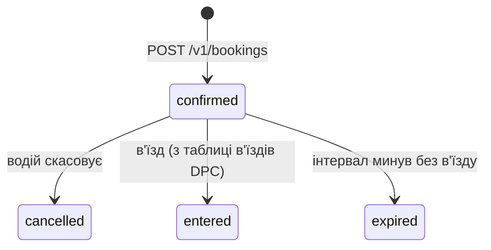
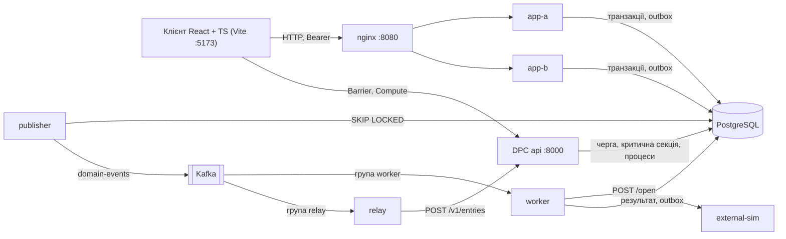
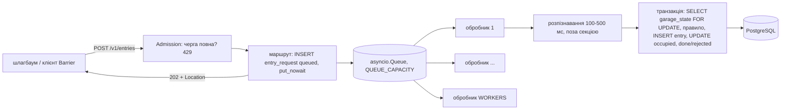
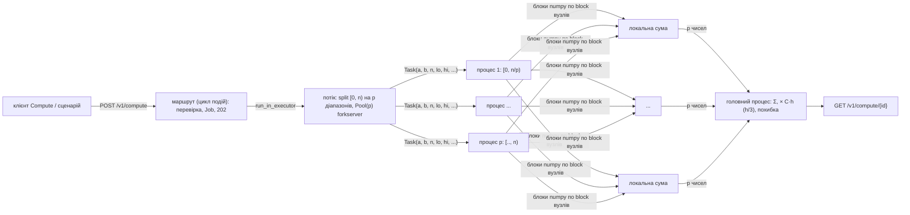

# C09 «Паркінги» - спільний проєкт курсів «Обмін даними у Web-застосунках» і «Розподілені та паралельні обчислення»

Структура - за `README-template.md` обох курсів. Опис наданих каркасів - [web/KIT-README.md](web/KIT-README.md),
[dpc/KIT-README.md](dpc/KIT-README.md). Повні результати й механізм кожної ЛР - `results/<частина>-lrN/README.md`.

## 1. Курс і тема

| | |
|---|---|
| Курси | «Обмін даними у Web-застосунках» (Web) і «Розподілені та паралельні обчислення» (DPC) |
| Тема | C09 «Паркінги» (спільна тема Web + DPC) |
| Команда | Вадим, Дарина |

## 2. Проєкт

Водій бронює місце на рівні паркінгу на кілька годин; шлагбаум відкривається за бронюванням.
Головне навантаження - вечір п'ятниці біля торгового центру: багато одночасних бронювань останніх місць.

- **Ролі:** `user` - водій (бачить лише свої бронювання); `staff` - оператор (закриває рівень).
- **Головна операція:** `POST /v1/bookings` - усі години й бронювання в одній транзакції, 201 після фіксації.
- **Інваріанти:** у кожну годину бронювань на рівні не більше, ніж місць (`level_hour.free >= 0`);
  бронювання кількох годин займає всі години або жодної.
- **Гроші й час:** копійки `bigint`, неповна година - повна, тариф копіюється в бронювання;
  `timestamptz`, зона - `garage.tz` (`Europe/Kyiv`).
- **Зовнішня система** (ЛР4) - симулятор шлагбаума `POST /open`: 1-3 с, 10 % відмов 503.
- **Зміна ЛР6** - місця із зарядкою; старий клієнт без типу бронює звичайне місце.



`held` з картки не використовується: окремого підтвердження немає. `entered` у базі не зберігається -
Web обчислює його з в'їздів DPC. Схема даних - `migrations/`, рішення - [docs/decisions.md](docs/decisions.md).

**Сутності (Web).**

| Сутність | Таблиця | Що зберігає |
|---|---|---|
| Паркінг | `garage(id, name, tz)` | назва й часова зона IANA |
| Рівень | `level(id, garage_id, name, spots, closed)` | кількість місць; закритий рівень не приймає нових бронювань |
| Тариф | `tariff(garage_id, minor_per_hour, currency)` | копійок за годину; **власник - DPC** (ЛР6), Web лише читає |
| Година рівня | `level_hour(level_id, hour, free)` | вільні місця в кожну годину |
| Бронювання | `booking(id, user_id, level_id, plate, from_hour, hours, tariff_minor_per_hour, price_minor, currency, status, version, created_at, expires_at)` | головна сутність |
| Користувач | `app_user(id, login, role, password_hash)` | роль `user` / `staff`, хеш пароля argon2id (ЛР3) |
| Сесія входу | `session(token_hash, user_id, created_at, expires_at)` | sha256 токена, строк 8 годин (ЛР3) |


**Числові параметри (навчальні припущення).**

| Параметр | Значення |
|---|---|
| Паркінги | `mall` «South Mall», `center` «City Centre», зона `Europe/Kyiv` (назви англійською, як в інтерфейсі клієнта) |
| Рівні | `mall-1` 40 місць, `mall-2` 40, `mall-one` 1 (для досліду гонки), `center-1` 20 |
| Тариф | `mall` 3000 коп./год, `center` 4000 коп./год, UAH |
| Тривалість бронювання | 1-24 години |
| Номер авто | текст 2-12 символів |
| Сторінка списку | `limit` 1-50, типово 20 |
| Користувачі (вхід ЛР3) | `u-1` user1 / `user1-pass`, `u-2` user2 / `user2-pass` (user), `s-1` staff1 / `staff1-pass` (staff) |
| Сесія входу | 8 годин (`SESSION_TTL_H`) |

## 3. Архітектура



### Спільний проєкт

Спільні лише PostgreSQL (одна база, спільна нумерація `migrations/`) і Kafka. Кожну таблицю змінює одна частина.

| Що | Хто змінює | Хто читає |
|---|---|---|
| каталог, `booking`, `level_hour`, користувачі, операції, outbox | Web | DPC читає `booking`, `level` у правилі в'їзду |
| зайнятість `garage_state`, `entry_request`, `entry` | DPC | Web обчислює `entered` з `entry` |
| `tariff` | DPC (ЛР6) | Web копіює в бронювання |

- **Web → DPC:** `relay` читає `entry.opened` з `domain-events` і надсилає `POST /v1/entries`
  (`event_id` = id операції, `booking_id`, `Idempotency-Key`). 202 - offset підтверджено; 429/5xx/мережа -
  повтор з паузою 1-8 с; інший 4xx остаточний.
- **Повтори:** той самий `event_id` DPC повертає тим самим запитом; другий в'їзд за бронюванням забороняє
  `UNIQUE (booking_id) WHERE direction = 'in'`.
- **Наскрізний приклад:** бронювання → «Open barrier» → операція `succeeded` → relay → в'їзд DPC `done` →
  бронювання `entered` у клієнті (`results/web-lr4/e2e.txt`). DPC зупинено на 20 с - relay дочекався,
  в'їзд записано один раз (`dpcdown.txt`).

## 4. Структура репозиторію

| Шлях | Призначення |
|---|---|
| `compose.yaml`, `.env.example` | спільний стенд обох частин |
| `migrations/` | спільні міграції PostgreSQL |
| `web/server/`, `web/openapi.yaml`, `web/asyncapi.yaml` | сервер Web і контракти |
| `web/client/` | клієнт React + TypeScript (поза Compose) |
| `dpc/api/`, `dpc/openapi.yaml` | сервіс DPC і контракт |
| `experiments/` | сценарії дослідів |
| `results/` | виводи перевірок і дослідів за ЛР |
| `docs/` | рішення, зміни плану, вимоги й стан пунктів |

## 5. Збирання й запуск

Потрібно: Docker Compose v2, ≥10 ГБ пам'яті для Docker (повний набір ≈3.9 ГіБ без навантаження),
`uv` для тестів і сценаріїв, Node.js 22 для клієнта. Усі команди - з кореня репозиторію.

```bash
cp .env.example .env
docker compose build app-a api coordinator-a spark-master external-sim   # по одному сервісу на образ
docker compose up -d
```

Для однієї ЛР досить її сервісів:

| ЛР | Команда |
|---|---|
| Web ЛР1-ЛР3 | `docker compose up -d nginx publisher` |
| Web ЛР4 | `docker compose up -d nginx publisher worker relay external-sim api` |
| DPC ЛР1-ЛР2 | `docker compose up -d api` |

Тести (проти запущеного стенда):

```bash
uv run --no-project --python 3.13 --with pytest --with httpx --with "psycopg[binary]" --with numpy pytest web/server/tests dpc/api/tests -v
```

Клієнт: `cd web/client && cp .env.example .env.local && npm install && npm run dev` → http://localhost:5173.

Адреси: Web API http://localhost:8080 (app-a :8001, app-b :8002), DPC api http://localhost:8000,
симулятор :8090, PostgreSQL :5432 (`app`/`app`), Kafka з хоста :9094, Kafka UI :8085 (профіль `observability`).
У Git Bash перед `docker compose exec` задайте `MSYS_NO_PATHCONV=1`.

## 6. Лабораторні роботи

Стан пунктів - [docs/requirements-web.md](docs/requirements-web.md), [docs/requirements-dpc.md](docs/requirements-dpc.md);
зміни плану - [docs/plan-changes.md](docs/plan-changes.md).

### Web ЛР1. Контракт, модель і перша операція

| Пункт | Де реалізовано | Перевірка та свідчення |
|---|---|---|
| О1.1 Модель | розділ 2, `docs/decisions.md` | діаграма станів, інваріанти |
| О1.2 Схема БД | `migrations/001`-`003`, `900`, `901` | PK/FK, CHECK `free >= 0`, застосування з нуля |
| О1.3 Контракт | `web/openapi.yaml` | lint - 0 помилок (`results/web-lr1/openapi-lint.txt`) |
| О1.4 Головна операція | `web/server/app/bookings.py` | 201 + `Location`; 409 без зміни годин (`test_lr1.py`) |
| О1.5 Список із курсором | `bookings.py`, `cursor.py` | 7 бронювань по 3 - без пропусків і повторів |
| О1.6 `/health`, журнал | каркас | `results/web-lr1/log-lines.txt` |
| О1.7 Клієнт | `web/client/` | бронювання, 409 як Problem Details |
| Д1.1 Правило за часом | `web/server/app/rules.py` | минула година → 422 (`test_rules.py`) |

### Web ЛР2. Конкуренція та повторення запитів

| Пункт | Де реалізовано | Перевірка та свідчення |
|---|---|---|
| О2.1 Інваріант | `bookings.py` (`_reserve_hours`): `FOR UPDATE` годин у порядку | «Останнє місце», 10×20 запитів: захист - 0 перевищень, без захисту - 34 години понад місця |
| О2.2 Ідемпотентність | `web/server/app/idempotency.py`, `migrations/004` | повтор → той самий `id`; інше тіло → 422; два одночасні → одне бронювання |
| О2.3 Втрачена відповідь | `fault("after_commit_before_response")` | app-a без відповіді, повтор на app-b → той самий `id`, `free` змінено один раз |
| О2.4 Повтори в клієнті | `web/client/src/retry.ts` | після мережевої помилки одне бронювання |
| Д2.4 Умовна зміна | `PATCH` + `ETag`/`If-Match` | 428, 200, 412 (`test_lr2.py::test_7`) |
| Д2.5 Повторне скасування | `POST …/cancel` | 5 одночасних → `free` +1 один раз |

Блокування рядків обрано замість SERIALIZABLE, щоб не повторювати помилки 40001 під гонкою.
Докладно: [results/web-lr2/README.md](results/web-lr2/README.md).

### Web ЛР3. Вхід і доступ

| Пункт | Де реалізовано | Перевірка та свідчення |
|---|---|---|
| О3.1 Вхід | `web/server/app/auth.py`, `migrations/006` | токен з app-a діє на app-b; після виходу 401 на обох; невідомий логін і неправильний пароль - однакові |
| О3.2 Доступ до об'єктів | власник у кожному SQL; `POST /v1/levels/{id}/close` лише `staff` | чуже бронювання → 404 як неіснуюче; user → 403 |
| О3.3 Браузерні запити | CORS рівно `CLIENT_ORIGIN`, `web/tools/evil-origin/` | сторонній сайт не читає відповідь, форма → 401 |
| О3.4 Клієнт | `LoginPage.tsx`, `AccessPage.tsx` | вхід, 404 на чуже, закриття рівня персоналом |

Непрозорий токен у `Authorization` (sha256 у таблиці `session`, 8 год) замість JWT і cookie: вихід діє
одразу, CSRF неможливий. Пароль - argon2id. Докладно: [results/web-lr3/README.md](results/web-lr3/README.md).

### Web ЛР4. Довгі операції, події й зовнішня система

Шлях операції «відкрити шлагбаум»:

```mermaid
sequenceDiagram
    participant C as Клієнт
    participant A as app-a / app-b
    participant DB as PostgreSQL
    participant P as publisher
    participant K as Kafka domain-events
    participant W as worker
    participant S as external-sim /open
    participant R as relay
    participant D as DPC api
    C->>A: POST /v1/bookings/{id}/entries (Idempotency-Key)
    A->>DB: BEGIN; booking FOR UPDATE; operation pending; outbox entry.requested; COMMIT
    A-->>C: 202, Location /v1/operations/{op}, Retry-After 2
    P->>DB: SELECT ... FOR UPDATE SKIP LOCKED
    P->>K: send (acks=all, key = booking id)
    P->>DB: published_at = now(); COMMIT
    K->>W: entry.requested (група worker)
    W->>DB: operation running
    W->>S: POST /open, Idempotency-Key = op id, тайм-аут 10 с
    S-->>W: accepted / rejected (503 - повтор)
    W->>DB: BEGIN; processed_message; operation succeeded|failed; notification; outbox entry.opened; COMMIT
    W->>K: commit offset
    P->>K: entry.opened
    K->>R: entry.opened (група relay)
    R->>D: POST /v1/entries, event_id = op id, booking_id
    D-->>R: 202 (повтор - той самий запит)
    C->>A: GET /v1/operations/{op} ... succeeded
    C->>A: GET /v1/bookings/{id} -> status entered (LEFT JOIN entry DPC)
```

| Тип | Де записується | `data` |
|---|---|---|
| `booking.created` | транзакція `POST /v1/bookings` | `user_id`, `level_id`, `from_hour`, `hours` |
| `entry.requested` | транзакція `POST …/entries` | `operation_id`, `user_id`, `garage_id`, `plate` |
| `entry.opened` | транзакція результату обробника | `operation_id`, `user_id`, `garage_id`, `plate`, `opened_at`, `effect_id` |

| Пункт | Де реалізовано | Перевірка та свідчення |
|---|---|---|
| О4.1 Асинхронна операція | `web/server/app/operations.py`, `migrations/007` | 202 + `Location` + `Retry-After`; повтор ключа - та сама операція |
| О4.2 Outbox | `events.py`, `publisher.py` | події в транзакції операції, усі опубліковані |
| О4.3 Обробник | `worker.py`, `retrying.py` | `pending → running → succeeded`, ефект 1, сповіщення 1 |
| О4.4 Відмови | `fault("publisher_before_send")`, `fault("after_external_before_commit")` | після перезапуску - один ефект, одне сповіщення |
| О4.5 Клієнт | `BookingsPage.tsx` («Open barrier») | «Opened at …», бейдж Parked |
| Д4.1 CloudEvents 1.0 | `events.py`, `web/asyncapi.yaml` | конверт у Kafka UI, AsyncAPI valid |

Доставка подій - щонайменше один раз; повтори відсікає `processed_message` і ключ симулятора = id операції.
Докладно: [results/web-lr4/README.md](results/web-lr4/README.md).

### Web ЛР5-ЛР6

_Заповнюється в ЛР5-ЛР6._

### DPC ЛР1. Сервіс із чергою та модель виконання

Ресурс - зайнятість паркінгу `garage_state(spots, occupied)`, ефект - рядок `entry`.



| Пункт | Де реалізовано | Перевірка та свідчення |
|---|---|---|
| О1.1 Приймання | `dpc/api/app/entries.py`, `migrations/005` | 202 + `Location` до оброблення |
| О1.2 Обмежена черга | `asyncio.Queue(QUEUE_CAPACITY)`, 429 до FastAPI | 396×202, 42263×429; `/health` p95 52.6 мс |
| О1.3 Пул обробників | рівно `WORKERS` задач | `in_flight` ≤ 4 |
| О1.4 Захист ресурсу | `SELECT … FOR UPDATE` у транзакції | без захисту 27 авто на 5 місць, із захистом 5 |
| О1.5 Час і метрики | `GET /v1/entries/{id}`, `/metrics` | відповідь 28 мс проти виконання 1647 мс (p50) |
| Д1.4 Завершення | SIGTERM → 503, дренаж черги | 50 запитів дооброблено за 4.0 с, втрат 0 |

Докладно: [results/dpc-lr1/README.md](results/dpc-lr1/README.md).

### DPC ЛР2. Паралельний чисельний розрахунок

Інтеграл заповненості паркінгу `O(t)` за день (машино-години); еталон - точна первісна.



| Пункт | Де реалізовано | Перевірка та свідчення |
|---|---|---|
| О2.1 Паралельне інтегрування | `dpc/api/app/integrate.py`, `compute.py` | 1, 2, 4 процеси, 3 методи, відносна похибка ≤ 1e-9 |
| О2.2 Точність | `experiments/dpc_lr2_compute.py accuracy` | E(n)/E(2n) = 16 і 4 за теорією |
| О2.3 Прискорення | `… bench`, профіль `py-spy` | S₄ 1.76; блок 10⁴ замість 10⁶ - S₄ 2.12 (обмеження - пам'ять) |
| О2.4 Спільна сума | режими `none` / `lock` / `local` | без блокування 0/5 у допуску, з ним 5/5 |

Клієнт - сторінки «Barrier» і «Compute» (`web/client/src/`). Докладно: [results/dpc-lr2/README.md](results/dpc-lr2/README.md).

### DPC ЛР3-ЛР6

_Заповнюється в ЛР3-ЛР6._

## 7. Досліди

Сценарії - з кореня: `uv run --no-project --python 3.13 --with httpx --with "psycopg[binary]" python experiments/<файл>.py`.

| Дослід | Команда | Результат |
|---|---|---|
| Останнє місце (Web О2.1) | `web_last_spot.py`; без захисту - `INVARIANT_MODE=unprotected` | `results/web-lr2/last-spot-*` |
| Втрачена відповідь (Web О2.3) | `bash experiments/web_lost_response.sh` | `results/web-lr2/lost-response.txt` |
| Ідемпотентність, скасування (Web О2.2, Д2.5) | `web_idempotency.py`, `web_cancel_twice.py` | `results/web-lr2/` |
| Вхід, доступ, CORS (Web ЛР3) | `web_lr3_checks.py` | `results/web-lr3/checks.txt` |
| Довга операція й відмови (Web ЛР4) | `web_lr4.py e2e\|publisher\|worker\|rejected\|simdown\|dpcdown` | `results/web-lr4/` |
| Черга, гонка, час, зупинка (DPC ЛР1) | `dpc_lr1_overload.py`, `_race`, `_timing`, `_drain` | `results/dpc-lr1/` |
| Точність, режими, прискорення (DPC ЛР2) | `dpc_lr2_compute.py accuracy\|modes\|bench\|health` | `results/dpc-lr2/` |

Умови, прогноз, вимірювання й висновки кожного досліду - у `results/<ЛР>/README.md`.

## 8. Межі гарантій і керовані відмови

Відмови вмикаються файлом-прапорцем (одноразово, `FAULTS=on`); Docker перезапускає процес.

| Відмова | Увімкнення |
|---|---|
| `after_commit_before_response` (Web ЛР2) | `docker compose exec app-a touch /faults/after_commit_before_response` |
| `publisher_before_send` (Web ЛР4) | `docker compose exec publisher touch /faults/publisher_before_send` |
| `after_external_before_commit` (Web ЛР4) | `docker compose exec worker touch /faults/after_external_before_commit` |
| SIGTERM з повною чергою (DPC Д1.4) | `docker compose stop api`, потім `docker compose start api` |

Перевірка - `fault.hit` у `docker compose logs <сервіс>`; повне скидання - `docker compose down -v`.

Головні межі:
- Ключ ідемпотентності захищає лише повтор з тим самим ключем; живе 24 год.
- Перехоплений токен діє до виходу або 8 год; кількість спроб входу не обмежена.
- Поки симулятор недоступний, обробник чекає на одній події без межі спроб.
- Черга DPC у пам'яті: аварія процесу (не SIGTERM) втрачає `queued`-запити (`lost-on-restart`).
- Прискорення DPC виміряно у ВМ з 4 логічними CPU (2 ядра × 2 потоки).

Повний перелік - у `results/<ЛР>/README.md`.

## 9. Внесок учасників

| Учасник | Реалізовані пункти й досліди |
|---|---|
| Дарина | Web ЛР1, ЛР3; DPC ЛР1, ЛР2; екрани клієнта |
| Вадим | Web ЛР2, ЛР4; інфраструктура, зв'язок Web↔DPC |

### Використані бібліотеки

| Бібліотека | Для чого | Де |
|---|---|---|
| FastAPI, psycopg | HTTP і PostgreSQL | `web/server/`, `dpc/api/` |
| aiokafka | публікація й читання подій | `publisher.py`, `worker.py`, `relay.py` |
| argon2-cffi | хеш пароля | `web/server/app/auth.py` |
| numpy, multiprocessing | обчислення блоками, пул процесів | `dpc/api/app/integrate.py` |
| React, Vite | клієнт | `web/client/` |
| py-spy, matplotlib | профіль і рисунки дослідів | `experiments/` |

Каркаси курсів: `a-kovt/web-interactions-course`, `a-kovt/distributed-parallel-computing-course` (MIT).
