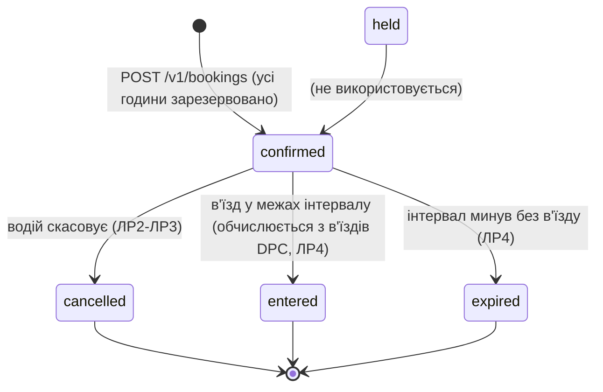
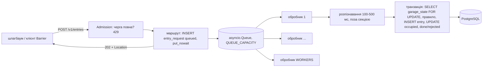
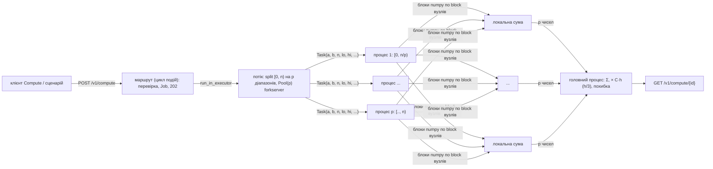

# C09 «Паркінги» - спільний проєкт курсів «Обмін даними у Web-застосунках» і «Розподілені та паралельні обчислення»

> Скелет за `README-template.md` обох курсів (`web/README-template.md`, `dpc/README-template.md`).
> Розділи заповнюються по мірі виконання лабораторних робіт. Опис наданих каркасів -
> [web/KIT-README.md](web/KIT-README.md), [dpc/KIT-README.md](dpc/KIT-README.md).

## 1. Курс і тема

| | |
|---|---|
| Курси | «Обмін даними у Web-застосунках» (Web) і «Розподілені та паралельні обчислення» (DPC) |
| Тема | C09 «Паркінги» (спільна тема Web + DPC) |
| Команда | Вадим, Дарина |

## 2. Проєкт

**Призначення.** Водій бронює місце на рівні паркінгу на кілька годин; шлагбаум відкривається за
бронюванням. Головне навантаження - вечір п'ятниці біля торгового центру: багато одночасних
бронювань останніх місць на години, що перетинаються.

**Ролі.** `user` - водій (бронює, бачить лише свої бронювання); `staff` - оператор паркінгу
(закриває рівень, ЛР3). До ЛР3 користувач передається заголовком `X-User-Id`.

**Сутності (Web).**

| Сутність | Таблиця | Що зберігає |
|---|---|---|
| Паркінг | `garage(id, name, tz)` | назва й часова зона IANA |
| Рівень | `level(id, garage_id, name, spots, closed)` | кількість місць; закритий рівень не приймає нових бронювань |
| Тариф | `tariff(garage_id, minor_per_hour, currency)` | копійок за годину; **власник - DPC** (ЛР6), Web лише читає |
| Година рівня | `level_hour(level_id, hour, free)` | вільні місця в кожну годину |
| Бронювання | `booking(id, user_id, level_id, plate, from_hour, hours, tariff_minor_per_hour, price_minor, currency, status, version, created_at, expires_at)` | головна сутність |
| Користувач | `app_user(id, login, role)` | роль `user` / `staff` |

**Головна операція** - `POST /v1/bookings`: забронювати місце на рівні на `hours` годин з
`from_hour`. Усі години й запис бронювання - в одній транзакції; відповідь 201 - після фіксації.

**Стани й переходи.**



Картка задає `held → confirmed → entered | expired | cancelled`. Окремого маршруту
підтвердження в картці немає, тому бронювання одразу створюється в `confirmed`, а `held` не
використовується; методичка дозволяє адаптувати структуру за збереження інваріантів.
`entered` у базі не зберігається: Web обчислює його з таблиці в'їздів частини DPC.

**Інваріанти.**
1. У кожну годину кількість бронювань на рівні не перевищує кількості місць на ньому:
   `level_hour.free = spots − активні бронювання години`, `CHECK (free >= 0)`.
2. Бронювання кількох годин займає всі години або жодної: усі рядки `level_hour` змінюються в
   транзакції, що створює бронювання; інакше відкат.

**Гроші й час.** Тариф - ціле число копійок за годину (`bigint`) і валюта; неповна година
рахується як повна, тому ціна = тариф × `hours`. Тариф на момент бронювання зберігається в
бронюванні. Моменти - `timestamptz`; назва зони - окремо в `garage.tz`. Інтервал
`[from_hour, from_hour + hours)` у цілих годинах; `from_hour` - початок години. Бронювання
23:00-01:00 займає дві дати. Доба для `GET /v1/levels/{id}/hours?day=` - календарна дата в зоні
паркінгу (у дні переходу на літній/зимовий час 23 або 25 годин).

**Числові параметри (навчальні припущення).**

| Параметр | Значення |
|---|---|
| Паркінги | `mall` «South Mall», `center` «City Centre», зона `Europe/Kyiv` (назви англійською, як в інтерфейсі клієнта) |
| Рівні | `mall-1` 40 місць, `mall-2` 40, `mall-one` 1 (для досліду гонки), `center-1` 20 |
| Тариф | `mall` 3000 коп./год, `center` 4000 коп./год, UAH |
| Тривалість бронювання | 1-24 години |
| Номер авто | текст 2-12 символів |
| Сторінка списку | `limit` 1-50, типово 20 |
| Користувачі | `u-1` user1, `u-2` user2 (user), `s-1` staff1 (staff) |

**Зовнішня система** (ЛР4) - симулятор контролера шлагбаума `POST /open`: 1-3 с, 10 % «немає
зв'язку» (503), одне відкриття на в'їзд. **Запланована зміна ЛР6** - місця із зарядкою для
електромобілів; запити старого клієнта без типу бронюють звичайне місце.

## 3. Архітектура

_Заповнюється в ЛР1-ЛР6._

### Спільний проєкт

Спільні лише PostgreSQL (одна база, одна папка `migrations/` зі спільною нумерацією) і Kafka. Кожну
таблицю змінює одна частина; інша читає вже зафіксований результат (рішення B1-B3).

| Що | Хто змінює | Хто читає |
|---|---|---|
| каталог `garage`, `level`, бронювання `booking`, `level_hour`, `app_user`, ключі ідемпотентності | Web (app-a/app-b) | DPC читає `booking` і `level` у правилі в'їзду |
| зайнятість `garage_state`, запити `entry_request`, в'їзди й виїзди `entry` | DPC (api) | Web обчислює стан `entered` бронювання з `entry` (B3, ЛР4) |
| тариф `tariff` | DPC (менеджер тарифу, ЛР6) | Web копіює його в бронювання |

Спільні ідентифікатори: `garage_id`, номер авто, `booking_id`. Як DPC читає бронювання Web: у критичній
секції в'їзду (рядок `garage_state` під `FOR UPDATE`) запит `SELECT … FROM booking JOIN level` лише на
читання. В'їзд за `booking_id` перевіряє, що бронювання існує, `confirmed`, номер збігається, `event_time`
у `[from_hour, expires_at)`, рівень належить цьому паркінгу й за бронюванням ще немає в'їзду; вільну квоту
не перевіряє (B4). В'їзд без бронювання враховує `reserved`: `confirmed`-бронювання рівнів паркінгу
(крім тестового `race-test`), інтервал яких містить `event_time` і за якими ще немає в'їзду (B6, B7, P3).
Другий в'їзд за тим самим бронюванням неможливий і в базі: `UNIQUE (booking_id) WHERE direction = 'in'`.
Повторна передача тієї самої події (Web у ЛР4, генератор) зберігає `event_id`; повтор - той самий запит (P6).

Перевірено наскрізно: бронювання через `POST /v1/bookings` Web, потім в'їзд за ним через `POST /v1/entries`
DPC (`experiments/dpc_lr1_rules.py`, `results/dpc-lr1/rules.txt`). Подія від Web до DPC через Kafka -
Web ЛР4 і DPC ЛР3.

## 4. Структура репозиторію

| Шлях | Призначення |
|---|---|
| `compose.yaml` | один спільний файл Compose для обох частин (профілі - розділ 5) |
| `.env.example` | змінні середовища обох частин (позначки `# Web`, `# DPC`, `# shared`) |
| `checks.yaml` | налаштування засобу перевірки: розділи `web:`, `dpc:`, `scenario:` |
| `migrations/` | спільні міграції PostgreSQL, нумерація `NNN` спільна для Web і DPC |
| `configs/migrate/` | `migrate.sh` - застосування міграцій (сервіс `migrate`) |
| `configs/prometheus/`, `configs/grafana/` | спільні Prometheus і Grafana; дашборди `web.json`, `dpc.json` |
| `web/` | частина Web: каркас курсу та код проєкту (`server/`, `client/`, `configs/`, `tools/`, `docs/`) |
| `dpc/` | частина DPC: каркас курсу та код проєкту (`api/`, `coordinator/`, `spark/`, `configs/`, `tools/`, `docs/`) |
| `web/client/` | клієнт React + TypeScript + Vite (поза Compose) |
| `web/client-kit/` | клієнт-приклад каркаса (довідка) |
| `web/server/tests/` | тести Web проти запущеного стенда (pytest) |
| `dpc/api/app/entries.py` | DPC ЛР1: приймач `/v1/entries`, черга, пул обробників, критична секція, завершення за SIGTERM |
| `dpc/api/app/integrate.py`, `dpc/api/app/compute.py` | DPC ЛР2: інтеграл заповненості, поділ, пул процесів, режими суми; маршрути `/v1/compute` |
| `dpc/api/tests/` | тести DPC проти запущеного стенда (pytest) |
| `dpc/openapi.yaml` | контракт DPC |
| `web/migrations-examples/`, `dpc/migrations-examples/` | приклади міграцій каркасів (не застосовуються) |
| `experiments/` | сценарії дослідів (`web_*.py`, `web_*.sh`, `web_invariant_check.sql`; `dpc_lr1_*.py`, `dpc_common.py`; `dpc_lr2_compute.py`, `dpc_lr2_plots.py`) |
| `results/` | збережені виводи перевірок і дослідів за ЛР (`web-lr1/`, `web-lr2/`, `dpc-lr1/`, `dpc-lr2/`) |
| `joint/` | наскрізний сценарій Web → DPC → Web (`scenario.example.py` - зразок каркаса) |
| `docs/` | рішення, стан проєкту, вимоги обох курсів, плани етапів, звіти |
| `CLAUDE.md` | правила роботи з репозиторієм для агента |

## 5. Збирання й запуск

### Вимоги

- Docker Engine з Docker Compose v2 (перевірено: Docker 28.4.0, Compose v2.39.4, Docker Desktop на Windows 11).
- Пам'ять (`docker stats --no-stream`, без навантаження, 2026-11-04, Docker з 11.7 ГіБ і 4 CPU):
  типовий набір **≈3.9 ГіБ**, разом з `observability` **≈4.8 ГіБ**. Під навантаженням Spark
  (worker `--memory 2g`, executor 1g) і Ray потребують більше. Рекомендовано **≥10 ГБ для Docker**;
  з 4 ГБ (WSL2) Docker Desktop зависав. На Windows ліміт задає `%USERPROFILE%\.wslconfig`
  (`[wsl2] memory=12GB`), після зміни: вийти з Docker Desktop, `wsl --shutdown`, запустити знову.
- Для роботи над однією частиною не потрібно запускати все (див. «Запуск частинами»).
- Вільні порти - таблиця нижче.

### Команди (з кореня репозиторію)

```sh
cp .env.example .env
docker compose config --quiet && echo CONFIG_OK
docker compose build app-a api coordinator-a spark-master external-sim
docker compose up -d
docker compose ps
```

Збирання вказано по одному сервісу на образ: кілька сервісів спільно використовують образи
`project-web`, `project-dpc-api`, `project-dpc-spark`, і паралельне `docker compose build` усіх
сервісів на Docker Desktop падає з `image ... already exists`.

Перевірка:

```sh
curl -fsS http://localhost:8080/health      # Web через nginx
curl -fsS http://localhost:8001/health      # app-a
curl -fsS http://localhost:8002/health      # app-b
curl -fsS http://localhost:8000/health      # DPC api
docker compose exec broker /opt/kafka/bin/kafka-topics.sh --bootstrap-server broker:9092 --list
docker compose run --rm migrate sh /migrate/migrate.sh --list
```

У Git Bash на Windows перед `docker compose exec/run` з абсолютними шляхами задайте `MSYS_NO_PATHCONV=1`.

Зупинка: `docker compose down`; з видаленням томів (база, стан симулятора, дані Spark): `docker compose down -v`.

### Запуск частинами

`docker compose up -d <сервіс>` піднімає сервіс разом із залежностями. Повний набір потрібен
для наскрізного сценарію й захисту.

| Що перевіряємо | Команда | Що підніметься |
|---|---|---|
| Web ЛР1-ЛР3, ЛР5-ЛР6 | `docker compose up -d nginx` | nginx, app-a/b, app-canary, gateway-a/b, postgres, broker |
| Web ЛР4 | `docker compose up -d nginx publisher worker router external-sim` | + outbox, обробник, симулятор |
| DPC ЛР1-ЛР2 | `docker compose up -d api` | api, postgres |
| DPC ЛР3 | `docker compose up -d api ray-worker` | + Ray |
| DPC ЛР4-ЛР5 | `docker compose up -d api spark-runner stream` | + Spark, broker |
| DPC ЛР6 | `docker compose up -d coordinator-a coordinator-b` | api, etcd, координатори |

### Профілі

| Профіль | Сервіси | Запуск |
|---|---|---|
| типовий | postgres, migrate, broker, broker-init, nginx, app-a, app-b, app-canary, publisher, worker, router, gateway-a, gateway-b, external-sim, flags, api, ray-head, ray-worker ×2, spark-master, spark-worker-1, spark-worker-2, spark-runner, stream, etcd, coordinator-a, coordinator-b | `docker compose up -d` |
| `observability` | prometheus, grafana, kafka-ui, otel-collector, jaeger | `docker compose --profile observability up -d` |
| `extras` | redis, keycloak, ray-worker-extra, spark-history | `docker compose --profile extras up -d` |

### Адреси

| Сервіс | Адреса | Частина |
|---|---|---|
| Web API (nginx) | http://localhost:8080 | Web |
| app-a, app-b | http://localhost:8001, http://localhost:8002 | Web |
| gateway-a, gateway-b | ws://localhost:8091, ws://localhost:8092 | Web |
| симулятор шлагбаума | http://localhost:8090 (`POST /open`) | Web |
| flagd | http://localhost:8099 | Web |
| DPC api | http://localhost:8000 | DPC |
| Ray dashboard | http://localhost:8265 | DPC |
| Spark master UI / job UI / stream UI | http://localhost:8280, :4040, :4041 | DPC |
| etcd | http://localhost:2379 | DPC |
| PostgreSQL | localhost:5432 (app/app, база `app`) | спільне |
| Kafka (з хоста) | localhost:9094 | спільне |
| Kafka UI | http://localhost:8085 (`observability`) | спільне |
| Prometheus | http://localhost:9090 (`observability`) | спільне |
| Grafana | http://localhost:3000 (`observability`) | спільне |
| Jaeger | http://localhost:16686 (`observability`) | Web |
| Keycloak / Redis / Spark history | :8180 / :6379 / :18080 (`extras`) | Web / Web / DPC |

Теми Kafka: `domain-events` (3), `domain-events.dlq` (1), `notifications` (3), `barrier-events` (1).
Клієнт (React + Vite) працює поза Compose на `http://localhost:5173` (`WEB_CLIENT_ORIGIN`, `DPC_CLIENT_ORIGIN`).

## 6. Лабораторні роботи

Стан пунктів - [docs/requirements-web.md](docs/requirements-web.md), [docs/requirements-dpc.md](docs/requirements-dpc.md).

### Web

#### ЛР1. Контракт, модель і перша операція

Відповідальна: Дарина. Звіт з ЛР здається окремим документом.

| Пункт | Де реалізовано | Перевірка та свідчення |
|---|---|---|
| О1.1 Модель області | розділ 2 цього README, [docs/decisions.md](docs/decisions.md) (M1-M11) | діаграма станів, інваріанти, числові параметри |
| О1.2 Схема БД | `migrations/001_c09_catalog.sql`, `002_c09_booking.sql`, `003_c09_booking_list_index.notx.sql`, `900_c09_seed.sql`, `901_c09_seed_en.sql` | PK/FK, NOT NULL, CHECK (`free >= 0`, початок години, `price = tariff × hours`, `expires_at`), UNIQUE; застосування з нуля - `docker compose up -d` на порожній базі |
| О1.3 Контракт API | `web/openapi.yaml` (`x-course: main/list/object`, приклади `normal`/`scarce`/`missing`) | `npx @redocly/cli lint web/openapi.yaml` - valid, 0 помилок |
| О1.4 Головна операція | `web/server/app/bookings.py` (`create_booking`, `_reserve_hours`) | тести 1-4, 7: 201 + `Location`; 409 без зміни жодної години; 400/404/422 |
| О1.5 Список із курсором | `web/server/app/bookings.py` (`list_bookings`), `web/server/app/cursor.py` | тест 5: 7 бронювань, `limit=3` → 3 сторінки без пропусків і повторів, зокрема з однаковим `created_at`; пошкоджений курсор - 400 |
| О1.6 Система, `/health`, журнал | каркас (`service.py`, `middleware.py`, `jsonlog.py`) | `docker compose up -d nginx` піднімає nginx, app-a, app-b, postgres; `/health` на :8080/:8001/:8002; рядок журналу JSON з `time`, `instance`, `route`, `status`, `duration_ms`, без `X-User-Id` |
| О1.7 Клієнт | `web/client/` (React + TypeScript + Vite) | бронювання, 409 як Problem Details, «Мої бронювання» читає всі сторінки - знімки у звіті ЛР1 |
| Д1.1 Правило за часом | `web/server/app/rules.py` (`booking_start_error(from_hour, now)`), PC-1 | `test_rules.py` (межі з фіксованим `now`), `test_lr1.py::test_8` (минула година → 422) |

Тести: `web/server/tests/test_lr1.py` - 10 тестів проти запущеного стенда, `test_rules.py` - 7 тестів
правила часу (чиста функція, Д1.1). Зміни плану - [docs/plan-changes.md](docs/plan-changes.md) (PC-1).

```bash
uv run --no-project --python 3.13 --with pytest --with httpx --with "psycopg[binary]" pytest web/server/tests -v
```

`--python 3.13` (або 3.12): без нього `uv` може взяти встановлений Python 3.10, де немає `datetime.UTC`.

Клієнт (потрібен Node.js 22):

```bash
cd web/client && cp .env.example .env.local && npm install && npm run dev
```

Відкрити http://localhost:5173 (походження дозволене CORS як `WEB_CLIENT_ORIGIN`).

#### ЛР2. Конкуренція та повторення запитів

Відповідальний: Вадим. Звіт з ЛР здається окремим документом. Досліди - розділ 7, межі й керована
відмова - розділ 8, рішення M13-M19 - [docs/decisions.md](docs/decisions.md), зміни плану PC-2, PC-3 -
[docs/plan-changes.md](docs/plan-changes.md).

| Пункт | Де реалізовано | Перевірка та свідчення |
|---|---|---|
| О2.1 Інваріант за одночасних запитів | `web/server/app/bookings.py` (`_reserve_hours`): в одній транзакції `SELECT … ORDER BY hour FOR UPDATE` рядків `level_hour` усіх годин, перевірка `free > 0`, `UPDATE … free = free - 1 … AND free > 0` з перевіркою кількості рядків, вставка бронювання | дослід «Останнє місце»: 10 раундів × 20 перетинних запитів через nginx на app-a і app-b - protected 0 годин понад місця, unprotected 34 години в 10 з 10 раундів (`results/web-lr2/last-spot-*.json`); SQL по всій базі - `invariant-check.txt`; `test_lr1.py::test_7` |
| О2.2 Механізм ідемпотентності | `web/server/app/idempotency.py`, `migrations/004_c09_idempotency.sql`; очищення - `web/server/app/publisher.py` | `test_lr2.py` 1-6, 11; дослід `results/web-lr2/idempotency.txt`: повтор → той самий `id` і `Idempotent-Replayed`, інше тіло → 422, без ключа → 400, 10 раундів по два одночасні запити з одним ключем → по одному бронюванню |
| О2.3 Повтор після втраченої відповіді | `fault("after_commit_before_response")` в `idempotency.execute` одразу після COMMIT | `experiments/web_lost_response.sh` → `results/web-lr2/lost-response.txt`: app-a - `curl: (52) Empty reply`, `fault.hit`; той самий ключ на app-b → 201 з тим самим `id`, бронювань 1, `free` 40 → 39 один раз |
| О2.4 Повторні спроби в клієнті | `web/client/src/retry.ts`, `BookingPage.tsx` | у браузері з відмовою на app-a: перший POST - мережева помилка, повтор із тим самим ключем → 201, одне бронювання (`results/web-lr2/client-retry.txt`); «We couldn't confirm your booking» (результат невідомий) + «Check my bookings» - знімок у звіті |
| Д2.4 Умовна зміна | `PATCH /v1/bookings/{id}` в `bookings.py` (`update_booking`), `ETag` у `GET`; клієнт «My bookings» → «Change plate» | `test_lr2.py::test_7`: 428, 200 + `ETag "2"`, 412 зі старим `ETag`, 422 для `status`/`version`/`user_id`/`level_id`/`from_hour`/`hours`, чуже → 404, скасоване → 409; 412 у клієнті - знімок у звіті |
| Д2.5 Повторне скасування | `POST /v1/bookings/{id}/cancel` в `bookings.py` (`cancel_booking`); клієнт «Cancel booking» | `test_lr2.py::test_8-10`; `results/web-lr2/cancel-twice.txt`: послідовно й 5 разів одночасно (app-a + app-b) - обидві відповіді 200 `cancelled v2`, `free` кожної з 3 годин +1 рівно один раз |

**Чому блокування рядків, а не атомарний умовний UPDATE чи SERIALIZABLE.** Бронювання займає
кілька рядків `level_hour` (до 24 годин), і всі години треба перевірити до будь-якої зміни (інваріант 2).
Один `UPDATE … WHERE free > 0` по діапазону змінив би вільні години й пропустив зайняту, тож довелося б
рахувати змінені рядки й відкочувати - це працює (і стоїть другим захистом після блокування), але не
каже, яка саме година зайнята. `SELECT … ORDER BY hour FOR UPDATE` блокує рядки в одному порядку для
всіх транзакцій, тому дві перетинні багатогодинні транзакції не чекають одна одну навхрест і
взаємоблокування не виникає; конкуренти тих самих годин просто чекають. SERIALIZABLE дав би той самий
результат, але з помилками серіалізації 40001, які сервер мусив би повторювати, а під гонкою за одне
місце таких повторів було б багато.

**Ідемпотентність.** Ключ належить користувачу: первинний ключ `(user_id, operation, key)`.
`request_hash` - sha256 методу, шаблону шляху й канонічного JSON тіла (ключі відсортовано). В одній
транзакції: `pg_try_advisory_xact_lock(hashtextextended(user:operation:key))` → не взято → 409
`idempotency-in-progress` з `Retry-After: 1`; є рядок ключа → інше тіло 422, те саме - збережена
відповідь із `Idempotent-Replayed: true`; немає → операція в точці збереження, підсумкова відповідь
(201, а також відмови 404 і 409) записується в той самий COMMIT, що й бронювання. Стан «в обробці» не є
рядком: це утримуване рекомендаційне блокування транзакції. Вона живе рівно стільки, скільки
транзакція, і звільняється автоматично при аварії процесу чи розриві з'єднання, тож «завислого» стану
не буває; рядок має лише `state = 'completed'`. Відповіді 400/422 перевірки даних не зберігаються:
ключ лишається вільним для виправленого запиту. Ключ живе 24 години (`IDEMPOTENCY_TTL_H`); `publisher`
раз на хвилину видаляє прострочені порціями по 1000 (`DELETE … WHERE ctid IN (SELECT … LIMIT 1000)`).

Три різні 409 розрізняє `type`: `no-free-spots`, `level-closed` - повторювати марно;
`idempotency-in-progress` - повторити з тим самим ключем. Клієнт повторює лише його, 502/503/504 і
відсутність відповіді (мережева помилка, тайм-аут 10 с): пауза - повний jitter
`random(0, min(8 с, 0.5 с·2^спроба))`, не менше `Retry-After`, не більше 5 спроб і 20 с очікування. Ключ
створюється один раз на натискання «Book», однаковий у всіх спробах і в «Try again»; зміна години,
рівня чи номера - нова дія з новим ключем. Якщо всі спроби лишилися без відповіді, форма показує
«We couldn't confirm your booking» (результат невідомий) і кнопку «Check my bookings», що перечитує «My bookings» і шукає це бронювання. Тексти для користувача не згадують ключів чи запитів.

Тести (`test_lr1.py` 10 + `test_lr2.py` 11 + `test_rules.py` 7 = 28) - стенд `docker compose up -d nginx publisher`.
Тести етапу 1 вже надсилали `Idempotency-Key` у кожному POST, змінювати їх не довелося.

#### ЛР3. Вхід і доступ
_Заповнюється в ЛР3._

#### ЛР4. Довгі операції, події й зовнішня система
_Заповнюється в ЛР4._

#### ЛР5. Сповіщення через WebSocket
_Заповнюється в ЛР5._

#### ЛР6. Зміна системи та поступове оновлення
_Заповнюється в ЛР6._

### DPC

#### ЛР1. Сервіс із чергою та модель виконання

Відповідальна: Дарина. Звіт з ЛР здається окремим документом. Рішення P1-P15 -
[docs/decisions.md](docs/decisions.md), зміни плану PC-4 - PC-7 - [docs/plan-changes.md](docs/plan-changes.md).
Досліди - розділ 7, межі гарантій і керована відмова - розділ 8. Вибрані пункти поза ядром: О1.5, Д1.4.

**Модель.** Ресурс - зайнятість паркінгу `garage_state(garage_id, spots, occupied)`; `spots` - сума місць
рівнів без тестового `race-test` (`mall` 81, `center` 20). Інваріант: `occupied` дорівнює кількості авто
всередині (прийняті в'їзди мінус виїзди з таблиці `entry`) і `0 ≤ occupied ≤ spots`. Ефект - рядок
`entry` з ключем `event_id`. Шлагбаум надсилає подію `POST /v1/entries`
`{event_id, garage_id, plate, direction, event_time, booking_id?}`; `event_time` - ISO 8601 UTC з `Z` і
мілісекундами. Повільний виклик картки - розпізнавання номера, 100-500 мс.



| Пункт | Де реалізовано | Перевірка та свідчення |
|---|---|---|
| О1.1 Приймання запитів | `dpc/api/app/entries.py` (`create_entry`, `get_entry`, `get_garage`), `migrations/005_dpc_entries.sql`, `903_dpc_seed.sql`, контракт `dpc/openapi.yaml` (`x-course: receiver / request-state / resource-state`) | 202 + `Location` до оброблення; стани `queued → processing → done / rejected / failed`; причини `full`, `booking-invalid`, `already-entered`, `already-inside`, `not-inside`; тести `test_accept_202_and_final_state`, `test_validation_and_auth`; `results/dpc-lr1/rules.txt` |
| О1.2 Обмежена черга й перевантаження | `asyncio.Queue(maxsize=QUEUE_CAPACITY)`; відмова 429 `Retry-After: 1` у шарі `entries.Admission` і в маршруті; запит із 429 не зберігається | дослід «Повна черга»: 396×202, 42263×429, черга повна в 51 з 60 замірів, `/health` p95 52.6 мс; `test_full_queue_429_not_stored` |
| О1.3 Пул обробників | `entries.start` створює рівно `WORKERS` задач `_worker`; `_process`: `processing` → `asyncio.sleep` розпізнавання → критична секція | `in_flight` ніколи не більший за `WORKERS` (4 у досліді); приймання не чекає на обробників: 429/202 відповідаються під час повної черги |
| О1.4 Захист ресурсу | `_apply_locked`: транзакція з `SELECT … FOR UPDATE`; `_apply_unsafe` (`RESOURCE_MODE=unsafe`, лише `dpc-race`) | дослід «Гонка за паркінг»: unsafe `occupied 5`, `inside 27`, `invariant_ok false`; locked 5 / 5 `true`; `test_invariant_after_200_parallel_requests` |
| О1.5 Час виконання й метрики | `Marks` (`time.monotonic_ns`), `GET /v1/entries/{id}`: `queue_wait_ms`, `processing_ms`, `total_ms`, `delivery_wait_ms`, `marks_ms`; `/metrics`: `queue_length`, `in_flight`, `rejected`, `rejected_rule`, `rejected_draining` | дослід «Час виконання»: порядок позначок 300 з 300; `test_time_marks_order`, `test_metrics` |
| Д1.4 Завершення роботи | `_install_sigterm`, `_drain_then_exit`: `draining` → 503, `queue.join()`, `api.drained`, потім завершення uvicorn | дослід «Зупинка з повною чергою»: 35×503 `Retry-After: 5`, `api.drained count=50` за 4.0 с, 61 прийнятий запит у кінцевому стані, `lost-on-restart` 0 |

**Примітив синхронізації черги й очікування обробника.** Черга - `asyncio.Queue`: усередині це
`collections.deque` і списки future для тих, хто чекає на `get` і `put` (за змістом - умовна змінна циклу
подій). Обробник у `await queue.get()` на порожній черзі реєструє свій future і віддає керування циклу;
цикл спить у `epoll` і не будить обробника, доки `put_nowait` не виконає `future.set_result`. Тому простій
обробника не займає CPU (у досліді без навантаження api використовує близько 1 % CPU). Усі задачі працюють в
одному потоці циклу подій, тож перевірка місткості `qsize() + reserving < QUEUE_CAPACITY` і `put_nowait`
не перериваються іншою задачею між ними (між ними є лише `await` вставки рядка, і на цей час місце
зарезервоване лічильником `reserving`).

**Критична секція.** Одна транзакція PostgreSQL: `SELECT spots, occupied FROM garage_state WHERE
garage_id = … FOR UPDATE` → правило (`occupied + reserved < spots` для в'їзду без бронювання, перевірки
бронювання, «номер усередині» для виїзду) → `INSERT INTO entry` → `UPDATE garage_state SET occupied =
occupied ± 1` → `entry_request` у `done`/`rejected` → COMMIT. Розпізнавання номера (100-500 мс) стоїть до
транзакції, тож блокування рядка паркінгу триває мілісекунди, а не сотні мілісекунд. Блокування в базі, а
не `asyncio.Lock`, бо в ЛР3 оброблення переходить у задачі Ray в інших процесах. `CHECK (occupied >= 0
AND occupied <= spots)` у таблиці - другий захист.

**Сторінка клієнта «Barrier»** (`web/client/src/BarrierPage.tsx`, `?view=barrier`): форма події
(паркінг, номер, напрям, необов'язковий `booking_id`), стан останнього запиту з причиною відмови, список
останніх запитів паркінгу (`GET /v1/entries?garage_id=`) і картка стану паркінгу (`spots`, `occupied`,
`inside`, `reserved`, `invariant_ok`), обидва опитуються раз на секунду. Клієнт звертається до DPC api
`:8000` з токеном `VITE_DPC_TOKEN` (`web/client/.env.local`); після 429 повторює ту саму подію (той самий
`event_id`) не раніше `Retry-After`.

Запуск і перевірка:

```bash
docker compose up -d api
uv run --no-project --python 3.13 --with pytest --with httpx --with "psycopg[binary]" pytest dpc/api/tests -v
npx @redocly/cli lint dpc/openapi.yaml
```

Тести (`dpc/api/tests/test_lr1.py`, 13) працюють проти запущеного стенда; кожен створює власний тестовий
паркінг `t-…` (без тарифу, каталог Web його не показує), а за потреби рівень, користувача й бронювання -
це фікстури тестів, сам сервіс таблиць Web не змінює.

#### ЛР2. Паралельний чисельний розрахунок

Відповідальна: Дарина. Звіт з ЛР здається окремим документом. Рішення P16-P20 -
[docs/decisions.md](docs/decisions.md), зміни плану PC-8 - PC-10 - [docs/plan-changes.md](docs/plan-changes.md).
Досліди - розділ 7, межі гарантій - розділ 8. Вибраний пункт поза ядром: О2.2. Д2.5 і Д2.6 не виконувались.

**Що рахуємо.** Заповненість паркінгу протягом робочого дня - модель картки C09
`O(t) = 16·Omax/T⁴ · t²(T − t)²`, `t ∈ [0; T]`, `T = 14` год. `Omax = 81` авто - навчальне припущення:
пік дорівнює місткості паркінгу `mall` з демоданих (P16). Інтеграл `∫ₐᵇ O(t) dt` - **машино-години** за
проміжок дня; машино-години × тариф за годину дають **виручку** паркінгу (наприклад, для звіту ЛР4).
Еталон - первісна `F(t) = C(T²t³/3 − T·t⁴/2 + t⁵/5)`, `C = 16·Omax/T⁴`, `F(b) − F(a)` у точній
раціональній арифметиці (`fractions.Fraction`), один раз округлена до `float`. На `[0; 14]` еталон
`8·Omax·T/15 = 604.8` машино-години. Генератор випадкових чисел не використовується: методи детерміновані.

**Маршрут.** `POST /v1/compute` `{a, b, n, workers: 1|2|4, method: midpoint|trapezoid|simpson, order,
mode: none|lock|local, block?, omax?}` → `202` + `Location` + `ComputeJob` (`state: running`); стан і
результат - `GET /v1/compute/{id}`, останні розрахунки - `GET /v1/compute?limit=`. Результат: `value`,
`reference`, `abs_error`, `rel_error`, `within_tolerance` (допуск `1e-9`), `seconds`, `pool_start_seconds`,
`workers`, `method`, `n`, `mode` і `timing` (склад часу). Невалідне тіло (`a ≥ b`, `b > 14`, `workers: 3`,
непарне `n` для Сімпсона, зайве поле) - 400 Problem Details. Одночасно - один розрахунок: другий `POST`
поки перший виконується - 429 `compute-busy`, `Retry-After: 2` (P18).

**Схема розрахунку і послідовна частина.**



Послідовна частина: перевірка тіла, поділ `[0, n)` (`integrate.split`: `p` неперервних діапазонів
`[lo, hi)`, розміри відрізняються не більше ніж на 1, без пропусків і перекриття), створення пулу, запуск
процесів і передавання `p` малих `Task` (кілька чисел, масиви не передаються), додавання `p` сум і множення
на `C·h`. Паралельна частина - обчислення вузлів і сум блоками numpy. Вузол `i` належить діапазону, що
містить `i`; останній вузол `n` (трапеції, Сімпсон) - лише останній частині; поправки ваг кінців
(`1/2` для трапецій, `1` замість `2` для Сімпсона) - у частинах, що містять вузли `0` і `n` (`end_terms`).
Тест порівнює паралельний результат на 1 і 4 процесах із простим циклом Python для `n = 1, 2, 3, 6, 10,
1002` на `[0; 14]` і `[2.5; 9]` (на `[0; 14]` `O(0) = O(14) = 0` і помилку ваг кінців не видно); він
знайшов ваду з `n < p`, коли порожні діапазони `(n, n)` теж додавали вузол `n` (виправлено, P17).

**Процеси й цикл подій.** Пул - `multiprocessing.get_context("forkserver").Pool(p)` на кожен розрахунок
(запуск пулу входить у вимірюваний час); forkserver заздалегідь імпортує numpy і `app.integrate`
(`set_forkserver_preload`). Створення пулу й очікування результатів виконуються в потоці
(`loop.run_in_executor`), тож цикл подій і обробники черги ЛР1 працюють далі; процеси пулу знижують свій
пріоритет (`os.nice(10)`, `COMPUTE_NICE`). Дослід: `/health` p95 8.0 мс під час безперервних розрахунків
p = 4 (у спокої 4.9 мс).

**Режими суми (О2.4).** `local` - кожен процес повертає свою суму. `none` - спільний
`multiprocessing.Value('d', lock=False)`, кожен процес після кожного блоку з `block = 1000` вузлів робить
`total.value += s` (читання, додавання, запис без синхронізації). `lock` - той самий код під
`with total.get_lock()`. Спільне значення передається процесам через `initializer` пулу (успадкування під
час запуску), а не аргументом задачі. Результат 5 запусків на 4 процесах: `none` 0 з 5 у допуску (втрачено
3-8 % суми), `lock` і `local` 5 з 5.

| Пункт | Де реалізовано | Перевірка та свідчення |
|---|---|---|
| О2.1 Паралельне інтегрування | `dpc/api/app/integrate.py` (`split`, `block_sum`, `end_terms`, `part_sum`, `run`, `reference`), `dpc/api/app/compute.py` (маршрути, один розрахунок, 429), контракт `dpc/openapi.yaml` | `test_1_2_4_workers_within_tolerance` (3 методи × p = 1, 2, 4, `n = 2·10⁷`, rel ≤ 1e-9), `test_small_n_parallel_equals_sequential` (36 випадків), `test_validation`, `test_second_computation_429` |
| О2.2 Точність | `experiments/dpc_lr2_compute.py accuracy` | `n` і `2n` для `n = 100…12800`, 3 методи, `[0; 14]` і `[0; 10]`; відношення 16/16/16 і 4/4/16; допуск 1e-9. `results/dpc-lr2/accuracy.{md,json}`, `accuracy.png` |
| О2.3 Прискорення | `experiments/dpc_lr2_compute.py bench`, `dpc/tools/bench_table.py`, профіль `py-spy` | `n = 6·10⁸`, p = 1, 2, 4, по 5 замірів: S₄ 1.76; гіпотеза «пам'ять, а не арифметика», блок 10⁶ → 10⁴: T₁ 3.78 → 1.15 с, S₄ 2.12. `results/dpc-lr2/speedup-*.md`, `timing-*.md`, `profile-p4.svg`, `speedup.png` |
| О2.4 Спільна сума | `part_sum` (`mode`), `run` (`Value` з `lock=False` або з блокуванням) | `experiments/dpc_lr2_compute.py modes`: `none` 0/5 і 0/3 (p = 4, 2), `lock` 5/5, `local` 5/5. `results/dpc-lr2/modes.md` |

**Сторінка клієнта «Compute»** (`web/client/src/ComputePage.tsx`, `?view=compute`): форма (`a`, `b`, `n`,
метод, 1/2/4 процеси, режим суми), картка результату (значення, еталон, абсолютна й відносна похибка,
ознака допуску, час і запуск пулу, найдовша частина, кількість процесів) і таблиця останніх розрахунків
(`GET /v1/compute`, раз на 2 с). Кнопка «Compare 1/2/4» запускає три розрахунки з тими самими параметрами
по черзі й показує `T_p`, `S_p`, `E_p`. Після 429 клієнт чекає `Retry-After` і повторює. Звертається до DPC
api `:8000` з тим самим `VITE_DPC_TOKEN`, що й «Barrier».

Запуск і перевірка:

```bash
docker compose up -d api
uv run --no-project --python 3.13 --with pytest --with httpx --with "psycopg[binary]" --with numpy pytest dpc/api/tests -v
curl -s -X POST localhost:8000/v1/compute -H 'Authorization: Bearer dev-token' -H 'Content-Type: application/json' \
  -d '{"a":0,"b":14,"n":20000000,"workers":4,"method":"midpoint"}'
```

Тести ЛР2 (`dpc/api/tests/test_lr2.py`, 23 + 2 пропущені: Сімпсон з непарним `n`) працюють проти запущеного
api; перевірка з послідовним циклом імпортує `app/integrate.py`, тому потрібен `--with numpy`.

#### ЛР3. Розподілена обробка в Ray і відновлення
_Заповнюється в ЛР3._

#### ЛР4. Пакетний звіт у Spark
_Заповнюється в ЛР4._

#### ЛР5. Потокова обробка, запізнення й відновлення
_Заповнюється в ЛР5._

#### ЛР6. Координація виконавців
_Заповнюється в ЛР6._

## 7. Досліди

### Web ЛР2

Спільні умови Web ЛР2: стенд `docker compose up -d nginx publisher` (nginx, app-a, app-b, postgres,
publisher), кожен дослід бере власні випадкові майбутні дати й нових користувачів. Сценарії Python
запускаються з кореня так: `uv run --no-project --python 3.13 --with httpx --with "psycopg[binary]" python experiments/<файл>.py`.

| Дослід | Режим і команда | Що видно / посилання на результат |
|---|---|---|
| Останнє місце (О2.1), protected | `docker compose up -d app-a app-b`, потім `experiments/web_last_spot.py` | 10 раундів × 20 запитів: 17×201, 183×409 `no-free-spots`; у жодній годині бронювань не більше за місця; `free = spots − бронювання` скрізь. `results/web-lr2/last-spot-protected.{json,txt}` |
| Останнє місце (О2.1), unprotected | `INVARIANT_MODE=unprotected docker compose up -d app-a app-b`, той самий сценарій, потім знову `docker compose up -d app-a app-b` | 115×201, 85×409; перевищення в 10 з 10 раундів, 34 години понад місця, до 12 бронювань на 1 місце. `results/web-lr2/last-spot-unprotected.{json,txt}` |
| Останнє місце на нових годинах | те саме з `--new-hours` | обидва режими без порушень (див. розділ 8, PC-2). `results/web-lr2/last-spot-*-new-hours.*` |
| Інваріант по всій базі | `docker compose exec -T postgres psql -U app -d app < experiments/web_invariant_check.sql` | години понад місця лише на `race-test` (34, з досліду unprotected); демо-рівні `mall-1`, `mall-2`, `mall-one`, `center-1` - 0. `results/web-lr2/invariant-check.txt` |
| Ключ ідемпотентності (О2.2) | `experiments/web_idempotency.py` | повтор на іншому екземплярі → той самий `id`; інше тіло → 422; без ключа → 400; 10 раундів по два одночасні запити з одним ключем → 13×201, 7×409 `idempotency-in-progress`, у кожному раунді 1 бронювання. `results/web-lr2/idempotency.txt` |
| Втрачена відповідь (О2.3) | `bash experiments/web_lost_response.sh` | див. таблицю нижче. `results/web-lr2/lost-response.txt` |
| Повтор у клієнті (О2.4) | відмова на app-a, «Book» у браузері | перший POST без відповіді, другий з тим самим ключем → 201 від app-b; одне бронювання. `results/web-lr2/client-retry.txt` |
| Повторне скасування (Д2.5) | `experiments/web_cancel_twice.py` | 1 раз послідовно + 5 разів одночасно: усі відповіді 200 `cancelled v2`, `free` кожної з 3 годин 40 → 39 → 40. `results/web-lr2/cancel-twice.txt` |

Режим без захисту (рішення M11, M14) змінює лише рівень `race-test` з міграції `902_c09_seed_race.sql`;
інші рівні в цьому режимі лишаються захищеними. Перед раундом сценарій створює рядки годин
`level_hour` (`free = 1`) - звичайний стан після першого бронювання цих годин.

| Поле | Останнє місце (О2.1) |
|---|---|
| Твердження | у жодній годині рівня бронювань не більше, ніж місць, за одночасних запитів через два екземпляри |
| Умови | рівень `race-test`, 1 місце; 10 раундів на різних датах; 20 запитів з бар'єром на інтервали 18:00+3, 19:00+2, 17:00+2, 20:00+1, 18:00+1 (по 4 кожного), два користувачі, ключі різні |
| Прогноз | protected - у кожній годині ≤ 1 бронювання, решта 409; unprotected - перевищення |
| Вимірювання | protected: 1-2 відповіді 201 на раунд (два непересічні інтервали, наприклад 17:00+2 і 20:00+1), app-a/app-b ≈ 101/99; unprotected: 2-20 відповідей 201 на раунд, до 12 бронювань в одній годині |
| Висновок | без блокування втрачене оновлення `free` дає перевищення в кожному раунді; з блокуванням рядків у порядку годин - жодного |

| Крок досліду «Втрачена відповідь» (О2.3) | Результат |
|---|---|
| `docker compose exec app-a touch /faults/after_commit_before_response` | файл у спільному томі `/faults` |
| POST з ключем K напряму на app-a `:8001` | `curl: (52) Empty reply from server`, код 000 |
| журнал app-a | `{"event": "fault.hit", "place": "after_commit_before_response"}`, потім `app.started` (Docker перезапустив) |
| стан до повтору | бронювань користувача 1, ключ збережено з відповіддю 201 |
| той самий запит із K на app-b `:8002` | 201, той самий `Location`, `Idempotent-Replayed: true`, `X-Instance: app-b` |
| SQL після | бронювань цього тіла 1; `id` у збереженій відповіді = бронювання в таблиці; `free` двох годин 40 → 39 один раз; файл відмови видалено |

### DPC ЛР1

Середовище: Windows 11, Intel Core i5-13420H (8 ядер, 12 потоків), 31.5 ГіБ RAM; Docker Desktop 28.4.0,
віртуальна машина WSL2 з 4 CPU і 11.7 ГіБ (`results/dpc-lr1/machine.txt`). Генератори працюють на хості
Windows (поза Compose) і звертаються до `localhost:8000`. Сценарії - з кореня:
`uv run --no-project --python 3.13 --with httpx --with aiohttp --with "psycopg[binary]" python experiments/<файл>.py`.
Сценарії самі перестворюють `api` з потрібними змінними (`docker compose up -d --force-recreate --no-deps api`)
і повертають типові значення. Досліди О1.2, О1.4, О1.5, Д1.4 працюють на тестовому паркінгу `dpc-race`
(5 місць, міграція 903) і перед запуском скидають лише його.

| Дослід | Режим і команда | Дані | Що видно |
|---|---|---|---|
| Повна черга (О1.2) | `QUEUE_CAPACITY=50 WORKERS=4`, `experiments/dpc_lr1_overload.py` | 60 клієнтів aiohttp без пауз 30 с; `/health` 10 разів/с з окремого процесу | 42659 POST за 30 с: 396×202, 42263×429; `queue_length` ≥ 48 у 51 з 60 замірів, `in_flight` max 4; `/health` 300 замірів: p50 6.4, **p95 52.6**, p99 78.0, max 119.8 мс, усі 200. `results/dpc-lr1/overload.{txt,json}` |
| Повна черга, засіб комплекту | `uv run --no-project --python 3.14 python dpc/tools/load.py http://127.0.0.1:8000/v1/entries experiments/dpc_entry_body.json --requests 6000 --concurrency 60` | 6000 запитів, 60 потоків | 600.7 запитів/с: 159×202, 5841×429. `results/dpc-lr1/load-tool.txt` |
| Гонка за паркінг (О1.4) | `WORKERS=8`, `RESOURCE_MODE=unsafe`, потім `locked`; `experiments/dpc_lr1_race.py` | 40 авто, 200 запитів (в'їзд, після прийнятого - виїзд) | див. таблицю нижче. `results/dpc-lr1/race.{txt,json}` |
| Час виконання (О1.5) | типові, `experiments/dpc_lr1_timing.py` | 300 запитів, 20 клієнтів, опитування GET кожні 50 мс | див. таблицю нижче. `results/dpc-lr1/timing.{txt,json}` |
| Зупинка з повною чергою (Д1.4) | типові, `experiments/dpc_lr1_drain.py` | 80 одночасних POST, одразу `docker compose stop api`, проба POST кожні 100 мс | 54×202 + 26×429; черга 50, обробляються 4; 35×503 `Retry-After=5` під час зупинки; `api.draining queued=46 processing=4` → `api.drained count=50 seconds=4.0` → `api.stopped`; зупинка 8.8 с, код виходу 0; усі 61 прийнятий запит (54 + 7, прийняті пробою до сигналу) - `done` 5, `rejected/full` 56, і так само після `docker compose start api`. `results/dpc-lr1/drain.txt` |
| Правила на демоданих | `docker compose up -d nginx api`, `experiments/dpc_lr1_rules.py` | бронювання через Web API на поточну годину, `mall-1` | в'їзд за бронюванням `done` (`reserved` 1 → 0); другий в'їзд за ним `already-entered`; виїзд без в'їзду `not-inside`; той самий `event_id` двічі - той самий `Location`, 1 запит у базі; інший номер `booking-invalid`; рядок `booking` лишився `confirmed`. `results/dpc-lr1/rules.txt` |

О1.4, `dpc-race` (5 місць), 40 авто, 200 запитів, WORKERS=8:

| Режим | В'їздів | Виїздів | `occupied` | `inside` | `invariant_ok` | Стани запитів |
|---|---|---|---|---|---|---|
| unsafe | 59 | 32 | 5 | 27 | **false** | в'їзд: 59 done, 86 full, 13 already-inside; виїзд: 32 done, 10 failed (`CHECK occupied >= 0`) |
| locked | 25 | 20 | 5 | 5 | true | в'їзд: 25 done, 155 full; виїзд: 20 done |

Без блокування кілька обробників читали те саме `occupied`, чекали 50 мс і записували своє значення:
оновлення губилися, всередині опинилося 27 авто на 5 місць, а лічильник показував 5; частина виїздів
записала б від'ємне значення, і `CHECK` перетворив їх на `failed`. З блокуванням той самий сценарій дав
`occupied = inside = 5 ≤ spots`.

О1.5, 300 запитів, 20 клієнтів (кожен: POST, далі GET кожні 50 мс до кінцевого стану), QUEUE_CAPACITY=50,
WORKERS=4. Вибірка - кожен запит прогону один раз; позначки - монотонний годинник процесу api.

| Інтервал | Що вимірює | p50 | p95 | p99 | max, мс |
|---|---|---|---|---|---|
| `post_http_ms` | клієнт: POST надіслано → 202 отримано (час відповіді HTTP) | 28.0 | 132.9 | 168.1 | 191.5 |
| `queue_wait_ms` | сервіс: надходження → початок оброблення | 1305.0 | 1596.5 | 1710.9 | 1761.2 |
| `processing_ms` | сервіс: початок → кінець (розпізнавання + транзакція) | 343.5 | 529.7 | 572.8 | 613.4 |
| `total_ms` | сервіс: надходження → кінець, **повне виконання** | 1647.1 | 2022.7 | 2153.9 | 2291.9 |
| `delivery_wait_ms` | сервіс: кінець → перший GET із кінцевим станом | 48.7 | 107.6 | 134.9 | 179.7 |

Порядок `received ≤ started ≤ finished ≤ delivered` - 300 з 300. Час відповіді HTTP (28 мс) у 59 разів
менший за повне виконання (1647 мс): 202 повертається до оброблення, а повне виконання складається
переважно з очікування в черзі (20 клієнтів на 4 обробники).

### DPC ЛР2

Середовище: те саме, що в ЛР1. Хост: Intel Core i5-13420H, 8 фізичних ядер (4 продуктивні з
Hyper-Threading + 4 енергоефективні), 12 логічних процесорів. Docker Desktop 28.4.0 у ВМ WSL2,
`.wslconfig` `processors=4`: у контейнері api `nproc = 4`, `lscpu` - 2 ядра × 2 потоки, L2 2.5 МіБ
(2 екземпляри), L3 12 МіБ; обмеження CPU у cgroup немає (`cpu.max: max`). Які ядра хоста дістаються
віртуальним CPU, визначає Hyper-V. `results/dpc-lr2/cpu.txt`. Сценарії - з кореня:
`uv run --no-project --python 3.13 --with httpx --with numpy python experiments/dpc_lr2_compute.py <дослід>`;
рисунки - `uv run --no-project --python 3.13 --with matplotlib python experiments/dpc_lr2_plots.py`.
Вимірюваний час - `seconds` із результату (від створення пулу до об'єднаного значення, годинник
`time.monotonic` сервера), не час HTTP.

| Дослід | Режим і команда | Дані | Що видно |
|---|---|---|---|
| Точність (О2.2) | `... accuracy` | `n = 100·2ᵏ`, k = 0…7, p = 1, 3 методи, `[0; 14]` і `[0; 10]` | `[0; 14]`: E(n)/E(2n) = 16.00 для всіх трьох методів; `[0; 10]`: 4.00, 4.00, 16.00. `results/dpc-lr2/accuracy.{md,json,png}` |
| Режими суми (О2.4) | `... modes` | `n = 2·10⁷`, `block = 1000` (20000 спільних оновлень), 5 запусків на p = 4 + `none` на p = 2 і 1 | див. таблицю нижче. `results/dpc-lr2/modes.{md,json}` |
| Прискорення (О2.3) | `... bench --n 600000000 --label base` | p = 1, 2, 4 по черзі, 5 кіл, перед ними 1 прогрівання (старт forkserver) | див. таблиці нижче. `results/dpc-lr2/bench-base.{csv,json}`, `speedup-base.md`, `timing-base.md` |
| Профіль p = 4 | `docker compose exec api py-spy record --subprocesses --pid 1 --rate 100 --duration 10 -o /tmp/profile-p4.svg` під час розрахунків `n = 4·10⁸`, p = 4 | 2654 вибірки (формат `raw`) | 93.4 % вибірок у `part_sum`; рядки, що виділяють нові масиви по 8 МБ (`np.arange` 24.0 %, `np.subtract` 24.8 %), проти 5.7-9.3 % у кожного з п'яти рядків, що проходять той самий обсяг на місці. `results/dpc-lr2/profile-p4.{svg,txt}` |
| Гіпотеза: блок 10⁴ | `... bench --n 600000000 --block 10000 --label block1e4` | те саме, без профайлера | див. таблиці нижче. `results/dpc-lr2/*-block1e4.*`, `speedup.png` |
| `/health` під розрахунком | `... health --n 600000000 --seconds 20` | `/health` 10/с на власному з'єднанні; 5 с спокою, потім 10 розрахунків p = 4 поспіль | спокій p95 4.9 мс; під розрахунком 217 замірів: p50 3.0, **p95 8.0**, p99 12.8, max 15.5 мс. `results/dpc-lr2/health.md` |

О2.2. Оцінки похибки (h = (b − a)/n): середні прямокутники `|E| ≤ (b − a)h²/24 · max|O''|`, трапеції
`(b − a)h²/12 · max|O''|`, Сімпсон `(b − a)h⁴/180 · max|O⁽⁴⁾|`. `O` - многочлен 4-го степеня, `O⁽⁴⁾ = 24C`
стала, тому Сімпсон **не** точний, і його оцінка збігається з фактичною похибкою (на `[0; 14]`, n = 100:
2.419e-5 і 2.419e-5). На `[0; 14]` `O'(0) = O'(14) = 0`, тож у формулі Ейлера-Маклорена член з `h²`
(`h²/12 · (O'(b) − O'(a))`) зникає, і середні прямокутники й трапеції там мають порядок `h⁴`: відношення 16,
а оцінка `h²` завищена в 3·10⁴ разів (PC-8). Щоб побачити порядок `h²`, узято `[0; 10]`, де
`O'(10) ≠ O'(0)`: відношення 4.00 і 4.00. Фрагмент (повна таблиця - `accuracy.md`):

| [a; b] | метод | n | E(n) | оцінка | E(n)/E(2n) |
|---|---|---|---|---|---|
| [0; 14] | midpoint | 100 | 5.292e-06 | 1.512e-01 | 16.00 |
| [0; 14] | trapezoid | 100 | 6.048e-06 | 3.024e-01 | 16.00 |
| [0; 14] | simpson | 100 | 2.419e-05 | 2.419e-05 | 16.00 |
| [0; 10] | midpoint | 100 | 6.748e-03 | 5.510e-02 | 4.00 |
| [0; 10] | trapezoid | 100 | 1.350e-02 | 1.102e-01 | 4.00 |
| [0; 10] | simpson | 100 | 4.498e-06 | 4.498e-06 | 16.00 |
| [0; 14] | midpoint | 6400 | 3.411e-13 | 3.691e-05 | 3.00 |

Від `n ≈ 6400` на `[0; 14]` похибка методу (≈ 3·10⁻¹³) доходить до похибки округлення, і відношення
перестає бути 16. Допуск округлення: сума частини - numpy попарно всередині блоку (`≈ log₂ block` кроків) і
послідовно між блоками, тож відносна похибка ≲ `ε·(log₂ block + n/block + 2)` = 9.4e-14 для `n = 4·10⁸`,
`block = 10⁶` (`ε` = 2.2e-16); у режимах `none`/`lock` (`n/1000` послідовних додавань) при `n = 10⁹` ≲ 2.2e-10.
Фактично на `n = 2·10⁷…6·10⁸` відносна похибка 0…3.2e-15. Обраний `tolerance = 1e-9` (`checks.yaml`): більший
за оцінку округлення для всіх допустимих `n ≤ 10⁹`; похибка методу на `[0; 14]` стає меншою за нього з
`n = 200` (середні прямокутники, трапеції) і `n = 400` (Сімпсон), тож для навантажувальних `n ≥ 10⁶` вона
не впливає на перевірку. Втрата одного блоку в
режимі `none` дає ≥ 5·10⁻⁵, тобто в 5·10⁴ разів більше за допуск.

О2.4, `n = 2·10⁷`, `block = 1000`, еталон 604.8, допуск 1e-9:

| Режим | p | Запусків | Значення, мін - макс | Макс. відносна похибка | У допуску | Обчислення, с (медіана) |
|---|---|---|---|---|---|---|
| none | 4 | 5 | 555.235190 - 586.938876 | 8.20e-02 | **0/5** | 0.051 |
| lock | 4 | 5 | 604.800000 - 604.800000 | 3.20e-15 | 5/5 | 0.069 |
| local | 4 | 5 | 604.800000 - 604.800000 | 1.88e-16 | 5/5 | 0.065 |
| none | 2 | 3 | 547.169308 - 588.321900 | 9.53e-02 | **0/3** | 0.067 |
| none | 1 | 2 | 604.800000 - 604.800000 | 5.64e-15 | 2/2 | 0.103 |

`total.value += s` - три кроки (читання спільної пам'яті, додавання, запис); якщо між читанням і записом
одного процесу інший процес записав свою суму, вона перезаписується. Втрачено 3-9.5 % суми, щоразу різну
частку; з одним процесом нічого не губиться. Блокування повертає точний результат ціною 35 % часу
обчислення відносно `none` (0.069 проти 0.051 с: 20000 захоплень блокування); `local` не має спільних
оновлень (його блок 10⁶, тому час близький до `lock`).

О2.3, `n = 6·10⁸`, midpoint, 5 замірів на кожне p (`dpc/tools/bench_table.py`):

| Блок | p | T_p, с (медіана) | Розкид, с | S_p | E_p |
|---|---|---|---|---|---|
| 10⁶ (типовий) | 1 | 3.776 | 0.636 | 1.00 | 1.00 |
| 10⁶ | 2 | 2.707 | 0.872 | 1.39 | 0.70 |
| 10⁶ | 4 | 2.150 | 0.374 | 1.76 | 0.44 |
| 10⁴ | 1 | 1.145 | 0.130 | 1.00 | 1.00 |
| 10⁴ | 2 | 0.702 | 0.039 | 1.63 | 0.82 |
| 10⁴ | 4 | 0.541 | 0.176 | 2.12 | 0.53 |

Склад часу (медіани, с; `timing` результату):

| Блок | p | Запуск пулу | Запуск процесів і передавання частин | Обчислення (найдовша частина) | Об'єднання | Разом | Зупинка пулу (не в «разом») |
|---|---|---|---|---|---|---|---|
| 10⁶ | 1 | 0.007 | 0.061 | 3.710 | 0.0008 | 3.776 | 0.002 |
| 10⁶ | 4 | 0.030 | 0.072 | 2.032 | 0.0005 | 2.150 | 0.005 |
| 10⁴ | 1 | 0.007 | 0.063 | 1.073 | 0.0012 | 1.145 | 0.002 |
| 10⁴ | 4 | 0.021 | 0.079 | 0.452 | 0.0007 | 0.541 | 0.004 |

**Гіпотеза за профілем.** Час частини йде не на арифметику: рядки `np.arange` і `np.subtract`, які щоразу
створюють новий масив на 10⁶ чисел (8 МБ), займають 49 % вибірок, а п'ять рядків, що проходять той самий
масив на місці (`x += 0.5`, `x *= h`, `x += a`, `y *= x`, `y *= y`), - по 5.7-9.3 %. Масиви по 8 МБ не
вміщаються в L2 (1.25 МіБ на ядро), а четверо процесів разом (≈ 64 МБ) - і в спільний L3 на 12 МіБ; кожен
прохід іде в пам'ять, а нові сторінки ще й обнуляє ядро ОС. Пропускна здатність пам'яті спільна для всіх
процесів, тому прискорення обмежене. Змінили один параметр - розмір блоку 10⁶ → 10⁴ (масиви по 80 КБ, у
L2), задача (`n = 6·10⁸`, midpoint) і точність (rel ≤ 3.8e-16) ті самі, профайлер вимкнено.

**Результат.** Гіпотеза підтвердилась щодо часу: T₁ 3.78 → 1.15 с (у 3.3 раза), T₄ 2.15 → 0.54 с.
Прискорення зросло менше: S₄ 1.76 → 2.12, E₄ 0.44 → 0.53. Друге обмеження - ВМ має 4 логічні CPU, тобто 2
ядра × 2 потоки Hyper-Threading: два потоки одного ядра ділять його векторні блоки, тому від 2 до 4
процесів час обчислення зменшився лише з 0.635 до 0.452 с (у 1.4 раза), а від 1 до 2 - у 1.7 раза.
Послідовна частина (запуск пулу й процесів, передавання частин) - 0.09-0.10 с, тобто 8 % T₁ для блоку 10⁴;
за законом Амдала це межа S₄ ≈ 3.2 навіть з чотирма повноцінними ядрами. Типовий блок сервісу лишається
10⁶, як у плані (P19); `block` у тілі запиту дозволяє його змінити.

## 8. Межі гарантій і керовані відмови

### Web ЛР2

Керована відмова `after_commit_before_response`: місце - `web/server/app/idempotency.py`, функція
`execute`, одразу після виходу з транзакції (бронювання й ключ зафіксовано, відповідь ще не віддано).

```sh
export MSYS_NO_PATHCONV=1                                          # лише Git Bash на Windows
docker compose exec app-a touch /faults/after_commit_before_response   # увімкнути (одноразово)
docker compose logs app-a | grep fault.hit                         # перевірити спрацювання
docker compose exec app-a rm -f /faults/after_commit_before_response   # вимкнути, якщо не спрацювала
```

Рядок журналу: `{"time": "…", "instance": "app-a", "event": "fault.hit", "place": "after_commit_before_response"}`.
Процес завершується `os._exit(1)`; uvicorn запущено одним процесом, тож клієнт справді не отримує
відповіді (curl: «Empty reply»; через nginx - 502 без заголовків CORS, браузер бачить мережеву помилку).
Відновлення: Docker перезапускає контейнер (`restart: unless-stopped`), `app.started` - через ≈1.4 с після `fault.hit`; файл видаляється в момент
спрацювання, тож вдруге відмова не стається. Початковий стан даних відновлювати не треба: досліди
працюють на власних датах і користувачах; повне скидання - `docker compose down -v`.

Що підтверджено й що ні:

- О2.1 перевірено 10 раундами по 20 запитів на одному рівні з 1 місцем і на наведених інтервалах;
  бар'єр клієнта узгоджує відправлення, але без журналу сервера не доводить перекриття критичних
  секцій. Відсутність порушень підтверджено SQL кінцевого стану, а не лише статусами відповідей.
- На годинах без рядка `level_hour` (перше бронювання години) запити серіалізує вже `INSERT … ON CONFLICT
  DO NOTHING` лінивого створення рядків: другий чекає фіксації першого. Тому unprotected на нових годинах
  порушень не показав; порівняння режимів чесне лише на наявних рядках (PC-2).
- Ключ ідемпотентності захищає лише запити з тим самим ключем. Дві окремі дії користувача (два ключі)
  створять два бронювання - це нові дії, а не повтор. Ключ живе 24 години; повтор пізніше виконає
  операцію знову.
- Рекомендаційне блокування береться за 64-бітним хешем `hashtextextended`; збіг хешів двох різних
  ключів дав би лише зайвий 409 `idempotency-in-progress`, а не втрату чи дублювання.
- Не досліджено: відмову PostgreSQL посеред транзакції, розрив з'єднання клієнта до COMMIT (тоді
  транзакція відкочується, і повтор виконує операцію вперше), відмову nginx.
- Скасування повторюється без ключа: його результат визначає стан рядка під `FOR UPDATE`. Зміна номера
  (`PATCH`) захищена версією `If-Match`, не ключем: повтор після втраченої відповіді отримає 412, і клієнт
  пропонує перечитати список.

### DPC ЛР1

Керована відмова Д1.4 - сигнал завершення з повною чергою; файл `/faults` не потрібен, відмову робить Docker:

```sh
docker compose stop api                                  # SIGTERM; stop_grace_period 120 s
docker compose logs api | grep -E 'api.draining|api.drained|api.stopped'
docker compose start api                                 # відновлення
```

Рядки журналу: `{"event": "api.draining", "queued": 46, "processing": 4}`, `{"event": "api.drained",
"count": 50, "seconds": 4.0}`, `{"event": "api.stopped"}`. Місце - `dpc/api/app/entries.py`
(`_install_sigterm`, `_drain_then_exit`). Відновлювати дані не треба; повне скидання тестового паркінгу
`dpc-race` роблять сценарії дослідів, усієї бази - `docker compose down -v`.

Що підтверджено й що ні:

- Черга живе в пам'яті процесу. Аварія процесу (`kill -9`, OOM, `fault`) втрачає запити в стані `queued`
  і `processing`: їхні рядки лишаються в базі, і під час наступного старту api позначає їх `failed` /
  `lost-on-restart` (P12). Повторити подію з тим самим `event_id` не вийде (це той самий, уже закритий
  запит), тому шлагбаум надсилає нову подію з новим `event_id`. Д1.4 охоплює лише коректне завершення
  за SIGTERM; пункт збереження черги після аварії не вимагає. Транзакція критичної секції атомарна: аварія
  посередині не залишає `entry` без зміни `occupied`.
- Межа очікування дренажу - `stop_grace_period: 120s`; при 50 запитах у черзі й 4 обробниках дренаж
  тривав 4.0 с. Якщо черга не встигне за 120 с, Docker надішле SIGKILL, і залишок стане `lost-on-restart`.
- Між `docker compose stop` і доставкою SIGTERM проходить близько 1.5 с, і запити цього часу ще приймаються
  (7 відповідей 202 у досліді); вони теж обробляються до завершення. Після `api.drained` uvicorn закриває
  порт, тож останні проби отримують відмову з'єднання, а не 503.
- О1.2 виміряно з клієнтами на тому самому комп'ютері (хост Windows → переадресація портів Docker
  Desktop): клієнт і сервіс ділять CPU. `/health` p95 ≤ 100 мс отримано лише після того, як відмови 429
  перейшли в шар ASGI до FastAPI (PC-6); без цього p95 був 121.6 мс. Відмови 429/503 не мають рядка
  журналу (лише лічильники `/metrics`).
- О1.4 доведено одним сценарієм на одному паркінгу; блокування рядка в PostgreSQL працює для кількох
  процесів, але в ЛР1 api - один процес. Узгодження фізичної зайнятості з бронюваннями Web обмежене
  PC-4: Web не бачить авто без бронювання, тож в'їзд за бронюванням може отримати `full`.
- Позначки часу О1.5 - у пам'яті процесу (останні 100 000 запитів) і зникають після рестарту; `received_at`
  / `finished_at` у базі зберігаються.

### DPC ЛР2

Керованих відмов у ЛР2 немає (Д2.6 «скасування» не вибрано). Що підтверджено й що ні:

- Результат відповідає еталону в допуску `1e-9` для 1, 2 і 4 процесів (тести, 3 методи) і в режимах
  `local`, `lock`; режим `none` навмисно губить оновлення й допуску не дотримується (0 з 8 запусків на 2 і 4
  процесах). Він існує лише для досліду О2.4, у клієнті підписаний «shared, no lock».
- Результати для різної кількості процесів не збігаються побітово: порядок сумування залежить від поділу
  (на `n = 2·10⁷` відносні похибки 0…3.8e-16). Тести порівнюють їх з допуском, а не на рівність.
- Одночасно один розрахунок (P18); другий отримує 429 і не стає в чергу. Розрахунки зберігаються в пам'яті
  процесу (останні 100) і зникають після рестарту api; під час зупинки процеси пулу, що рахують,
  завершуються без результату, а очікування SIGTERM черги ЛР1 (Д1.4) розрахунок не чекає.
- Прискорення виміряно у ВМ WSL2 з 4 логічними CPU (2 ядра × 2 потоки за `lscpu`) на ноутбуці з
  динамічною частотою; розкид T₁ для блоку 10⁶ - 0.64 с з 3.78 (17 %). Частина розкиду - інші процеси хоста
  (Docker Desktop, браузер); 5 замірів і медіана його згладжують, але не прибирають.
- `/health` швидкий під розрахунком, бо процеси пулу мають `nice 10` і цикл подій не чекає на пул; без
  `nice` не перевірялось. `n ≤ 10⁹`: при типовому блоці один процес рахує `10⁹` вузлів близько 6 с.
- Профіль знято з `--rate 100`; під час першого розрахунку py-spy відставав (`8.58s behind in sampling`),
  частки рядків узято з другого запису (формат `raw`, 2654 вибірки, без попереджень).

## 9. Внесок учасників

| Учасник | Реалізовані пункти й виконані досліди |
|---|---|
| Дарина | Web ЛР1 (О1.1-О1.7, Д1.1, Д1.2), екрани клієнта ЛР1; DPC ЛР1: О1.1-О1.5, Д1.4 - черга й пул обробників, захист зайнятості паркінгу, позначки часу, завершення за SIGTERM, сторінка клієнта «Barrier»; досліди «Повна черга», «Гонка за паркінг», «Час виконання», «Зупинка з повною чергою»; DPC ЛР2: О2.1-О2.4 - паралельний інтеграл заповненості, режими спільної суми, сторінка клієнта «Compute»; досліди «Точність», «Режими суми», «Прискорення» з профілем і гіпотезою, «`/health` під розрахунком» |
| Вадим | Web ЛР2: О2.1-О2.4, Д2.4, Д2.5 - ідемпотентність, умовна зміна, скасування, повтори в клієнті; досліди «Останнє місце», «Втрачена відповідь», «Ключ ідемпотентності», «Повторне скасування»; інфраструктура (етап 0) |

Розподіл ЛР: Дарина - Web ЛР1, ЛР3, ЛР6; DPC ЛР1, ЛР2, ЛР4 і екрани
клієнта; Вадим - Web ЛР2, ЛР4, ЛР5; DPC ЛР3, ЛР5, ЛР6, інфраструктура, зв'язок Web↔DPC.

### Використані бібліотеки

_Заповнюється в кожній ЛР._ Каркаси курсів: `a-kovt/web-interactions-course` (49fc428),
`a-kovt/distributed-parallel-computing-course` (527d718), ліцензія MIT (`web/KIT-LICENSE`, `dpc/KIT-LICENSE`). DPC ЛР2: `numpy` (обчислення блоками), `multiprocessing` стандартної бібліотеки (пул процесів, `Value`), `py-spy` (профіль), `matplotlib` (рисунки дослідів, лише в сценаріях); засіб комплекту `dpc/tools/bench_table.py` (таблиця прискорення).
