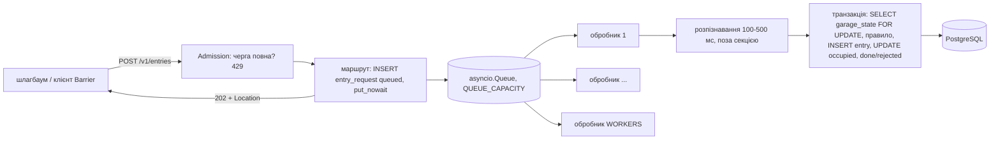

# DPC ЛР1. Сервіс із чергою та модель виконання: докладно

Скорочений опис і таблиця пунктів - [README.md](../../README.md), розділ 6. Тут - механізм, повні результати дослідів і межі гарантій.

## Схема



## Механізм

**Примітив синхронізації черги й очікування обробника.** Черга - `asyncio.Queue`: усередині це
`collections.deque` і списки future для тих, хто чекає на `get` і `put` (за змістом - умовна змінна циклу
подій). Обробник у `await queue.get()` на порожній черзі реєструє свій future і віддає керування циклу;
цикл спить у `epoll` і не будить обробника, доки `put_nowait` не виконає `future.set_result`. Тому простій
обробника не займає CPU (у досліді без навантаження api використовує близько 1 % CPU). Усі задачі працюють в
одному потоці циклу подій, тож перевірка місткості `qsize() + reserving < QUEUE_CAPACITY` і `put_nowait`
не перериваються іншою задачею між ними (між ними є лише `await` вставки рядка, і на цей час місце
зарезервоване лічильником `reserving`).

**Критична секція.** Одна транзакція PostgreSQL: `SELECT spots, occupied FROM garage_state WHERE
garage_id = … FOR UPDATE` → правило (`occupied + reserved < spots` для в'їзду без бронювання, перевірки
бронювання, «номер усередині» для виїзду) → `INSERT INTO entry` → `UPDATE garage_state SET occupied =
occupied ± 1` → `entry_request` у `done`/`rejected` → COMMIT. Розпізнавання номера (100-500 мс) стоїть до
транзакції, тож блокування рядка паркінгу триває мілісекунди, а не сотні мілісекунд. Блокування в базі, а
не `asyncio.Lock`, бо в ЛР3 оброблення переходить у задачі Ray в інших процесах. `CHECK (occupied >= 0
AND occupied <= spots)` у таблиці - другий захист.

**Сторінка клієнта «Barrier»** (`web/client/src/BarrierPage.tsx`, `?view=barrier`): форма події
(паркінг, номер, напрям, необов'язковий `booking_id`), стан останнього запиту з причиною відмови, список
останніх запитів паркінгу (`GET /v1/entries?garage_id=`) і картка стану паркінгу (`spots`, `occupied`,
`inside`, `reserved`, `invariant_ok`), обидва опитуються раз на секунду. Клієнт звертається до DPC api
`:8000` з токеном `VITE_DPC_TOKEN` (`web/client/.env.local`); після 429 повторює ту саму подію (той самий
`event_id`) не раніше `Retry-After`.

Запуск і перевірка:

```bash
docker compose up -d api
uv run --no-project --python 3.13 --with pytest --with httpx --with "psycopg[binary]" pytest dpc/api/tests -v
npx @redocly/cli lint dpc/openapi.yaml
```

Тести (`dpc/api/tests/test_lr1.py`, 13) працюють проти запущеного стенда; кожен створює власний тестовий
паркінг `t-…` (без тарифу, каталог Web його не показує), а за потреби рівень, користувача й бронювання -
це фікстури тестів, сам сервіс таблиць Web не змінює.

## Досліди

Середовище: Windows 11, Intel Core i5-13420H (8 ядер, 12 потоків), 31.5 ГіБ RAM; Docker Desktop 28.4.0,
віртуальна машина WSL2 з 4 CPU і 11.7 ГіБ (`results/dpc-lr1/machine.txt`). Генератори працюють на хості
Windows (поза Compose) і звертаються до `localhost:8000`. Сценарії - з кореня:
`uv run --no-project --python 3.13 --with httpx --with aiohttp --with "psycopg[binary]" python experiments/<файл>.py`.
Сценарії самі перестворюють `api` з потрібними змінними (`docker compose up -d --force-recreate --no-deps api`)
і повертають типові значення. Досліди О1.2, О1.4, О1.5, Д1.4 працюють на тестовому паркінгу `dpc-race`
(5 місць, міграція 903) і перед запуском скидають лише його.

| Дослід | Режим і команда | Дані | Що видно |
|---|---|---|---|
| Повна черга (О1.2) | `QUEUE_CAPACITY=50 WORKERS=4`, `experiments/dpc_lr1_overload.py` | 60 клієнтів aiohttp без пауз 30 с; `/health` 10 разів/с з окремого процесу | 42659 POST за 30 с: 396×202, 42263×429; `queue_length` ≥ 48 у 51 з 60 замірів, `in_flight` max 4; `/health` 300 замірів: p50 6.4, **p95 52.6**, p99 78.0, max 119.8 мс, усі 200. `results/dpc-lr1/overload.{txt,json}` |
| Повна черга, засіб комплекту | `uv run --no-project --python 3.14 python dpc/tools/load.py http://127.0.0.1:8000/v1/entries experiments/dpc_entry_body.json --requests 6000 --concurrency 60` | 6000 запитів, 60 потоків | 600.7 запитів/с: 159×202, 5841×429. `results/dpc-lr1/load-tool.txt` |
| Гонка за паркінг (О1.4) | `WORKERS=8`, `RESOURCE_MODE=unsafe`, потім `locked`; `experiments/dpc_lr1_race.py` | 40 авто, 200 запитів (в'їзд, після прийнятого - виїзд) | див. таблицю нижче. `results/dpc-lr1/race.{txt,json}` |
| Час виконання (О1.5) | типові, `experiments/dpc_lr1_timing.py` | 300 запитів, 20 клієнтів, опитування GET кожні 50 мс | див. таблицю нижче. `results/dpc-lr1/timing.{txt,json}` |
| Зупинка з повною чергою (Д1.4) | типові, `experiments/dpc_lr1_drain.py` | 80 одночасних POST, одразу `docker compose stop api`, проба POST кожні 100 мс | 54×202 + 26×429; черга 50, обробляються 4; 35×503 `Retry-After=5` під час зупинки; `api.draining queued=46 processing=4` → `api.drained count=50 seconds=4.0` → `api.stopped`; зупинка 8.8 с, код виходу 0; усі 61 прийнятий запит (54 + 7, прийняті пробою до сигналу) - `done` 5, `rejected/full` 56, і так само після `docker compose start api`. `results/dpc-lr1/drain.txt` |
| Правила на демоданих | `docker compose up -d nginx api`, `experiments/dpc_lr1_rules.py` | бронювання через Web API на поточну годину, `mall-1` | в'їзд за бронюванням `done` (`reserved` 1 → 0); другий в'їзд за ним `already-entered`; виїзд без в'їзду `not-inside`; той самий `event_id` двічі - той самий `Location`, 1 запит у базі; інший номер `booking-invalid`; рядок `booking` лишився `confirmed`. `results/dpc-lr1/rules.txt` |

О1.4, `dpc-race` (5 місць), 40 авто, 200 запитів, WORKERS=8:

| Режим | В'їздів | Виїздів | `occupied` | `inside` | `invariant_ok` | Стани запитів |
|---|---|---|---|---|---|---|
| unsafe | 59 | 32 | 5 | 27 | **false** | в'їзд: 59 done, 86 full, 13 already-inside; виїзд: 32 done, 10 failed (`CHECK occupied >= 0`) |
| locked | 25 | 20 | 5 | 5 | true | в'їзд: 25 done, 155 full; виїзд: 20 done |

Без блокування кілька обробників читали те саме `occupied`, чекали 50 мс і записували своє значення:
оновлення губилися, всередині опинилося 27 авто на 5 місць, а лічильник показував 5; частина виїздів
записала б від'ємне значення, і `CHECK` перетворив їх на `failed`. З блокуванням той самий сценарій дав
`occupied = inside = 5 ≤ spots`.

О1.5, 300 запитів, 20 клієнтів (кожен: POST, далі GET кожні 50 мс до кінцевого стану), QUEUE_CAPACITY=50,
WORKERS=4. Вибірка - кожен запит прогону один раз; позначки - монотонний годинник процесу api.

| Інтервал | Що вимірює | p50 | p95 | p99 | max, мс |
|---|---|---|---|---|---|
| `post_http_ms` | клієнт: POST надіслано → 202 отримано (час відповіді HTTP) | 28.0 | 132.9 | 168.1 | 191.5 |
| `queue_wait_ms` | сервіс: надходження → початок оброблення | 1305.0 | 1596.5 | 1710.9 | 1761.2 |
| `processing_ms` | сервіс: початок → кінець (розпізнавання + транзакція) | 343.5 | 529.7 | 572.8 | 613.4 |
| `total_ms` | сервіс: надходження → кінець, **повне виконання** | 1647.1 | 2022.7 | 2153.9 | 2291.9 |
| `delivery_wait_ms` | сервіс: кінець → перший GET із кінцевим станом | 48.7 | 107.6 | 134.9 | 179.7 |

Порядок `received ≤ started ≤ finished ≤ delivered` - 300 з 300. Час відповіді HTTP (28 мс) у 59 разів
менший за повне виконання (1647 мс): 202 повертається до оброблення, а повне виконання складається
переважно з очікування в черзі (20 клієнтів на 4 обробники).

## Керована відмова й межі гарантій

Керована відмова Д1.4 - сигнал завершення з повною чергою; файл `/faults` не потрібен, відмову робить Docker:

```sh
docker compose stop api                                  # SIGTERM; stop_grace_period 120 s
docker compose logs api | grep -E 'api.draining|api.drained|api.stopped'
docker compose start api                                 # відновлення
```

Рядки журналу: `{"event": "api.draining", "queued": 46, "processing": 4}`, `{"event": "api.drained",
"count": 50, "seconds": 4.0}`, `{"event": "api.stopped"}`. Місце - `dpc/api/app/entries.py`
(`_install_sigterm`, `_drain_then_exit`). Відновлювати дані не треба; повне скидання тестового паркінгу
`dpc-race` роблять сценарії дослідів, усієї бази - `docker compose down -v`.

Що підтверджено й що ні:

- Черга живе в пам'яті процесу. Аварія процесу (`kill -9`, OOM, `fault`) втрачає запити в стані `queued`
  і `processing`: їхні рядки лишаються в базі, і під час наступного старту api позначає їх `failed` /
  `lost-on-restart` (P12). Повторити подію з тим самим `event_id` не вийде (це той самий, уже закритий
  запит), тому шлагбаум надсилає нову подію з новим `event_id`. Д1.4 охоплює лише коректне завершення
  за SIGTERM; пункт збереження черги після аварії не вимагає. Транзакція критичної секції атомарна: аварія
  посередині не залишає `entry` без зміни `occupied`.
- Межа очікування дренажу - `stop_grace_period: 120s`; при 50 запитах у черзі й 4 обробниках дренаж
  тривав 4.0 с. Якщо черга не встигне за 120 с, Docker надішле SIGKILL, і залишок стане `lost-on-restart`.
- Між `docker compose stop` і доставкою SIGTERM проходить близько 1.5 с, і запити цього часу ще приймаються
  (7 відповідей 202 у досліді); вони теж обробляються до завершення. Після `api.drained` uvicorn закриває
  порт, тож останні проби отримують відмову з'єднання, а не 503.
- О1.2 виміряно з клієнтами на тому самому комп'ютері (хост Windows → переадресація портів Docker
  Desktop): клієнт і сервіс ділять CPU. `/health` p95 ≤ 100 мс отримано лише після того, як відмови 429
  перейшли в шар ASGI до FastAPI (PC-6); без цього p95 був 121.6 мс. Відмови 429/503 не мають рядка
  журналу (лише лічильники `/metrics`).
- О1.4 доведено одним сценарієм на одному паркінгу; блокування рядка в PostgreSQL працює для кількох
  процесів, але в ЛР1 api - один процес. Узгодження фізичної зайнятості з бронюваннями Web обмежене
  PC-4: Web не бачить авто без бронювання, тож в'їзд за бронюванням може отримати `full`.
- Позначки часу О1.5 - у пам'яті процесу (останні 100 000 запитів) і зникають після рестарту; `received_at`
  / `finished_at` у базі зберігаються.
