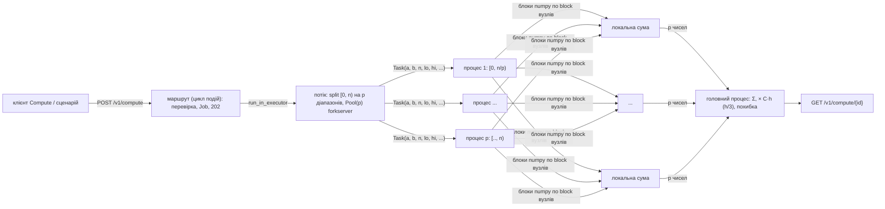

# DPC ЛР2. Паралельний чисельний розрахунок: докладно

Скорочений опис і таблиця пунктів - [README.md](../../README.md), розділ 6. Тут - механізм, повні результати дослідів і межі гарантій.

## Задача й маршрут

**Що рахуємо.** Заповненість паркінгу протягом робочого дня - модель картки C09
`O(t) = 16·Omax/T⁴ · t²(T − t)²`, `t ∈ [0; T]`, `T = 14` год. `Omax = 81` авто - навчальне припущення:
пік дорівнює місткості паркінгу `mall` з демоданих (P16). Інтеграл `∫ₐᵇ O(t) dt` - **машино-години** за
проміжок дня; машино-години × тариф за годину дають **виручку** паркінгу (наприклад, для звіту ЛР4).
Еталон - первісна `F(t) = C(T²t³/3 − T·t⁴/2 + t⁵/5)`, `C = 16·Omax/T⁴`, `F(b) − F(a)` у точній
раціональній арифметиці (`fractions.Fraction`), один раз округлена до `float`. На `[0; 14]` еталон
`8·Omax·T/15 = 604.8` машино-години. Генератор випадкових чисел не використовується: методи детерміновані.

**Маршрут.** `POST /v1/compute` `{a, b, n, workers: 1|2|4, method: midpoint|trapezoid|simpson, order,
mode: none|lock|local, block?, omax?}` → `202` + `Location` + `ComputeJob` (`state: running`); стан і
результат - `GET /v1/compute/{id}`, останні розрахунки - `GET /v1/compute?limit=`. Результат: `value`,
`reference`, `abs_error`, `rel_error`, `within_tolerance` (допуск `1e-9`), `seconds`, `pool_start_seconds`,
`workers`, `method`, `n`, `mode` і `timing` (склад часу). Невалідне тіло (`a ≥ b`, `b > 14`, `workers: 3`,
непарне `n` для Сімпсона, зайве поле) - 400 Problem Details. Одночасно - один розрахунок: другий `POST`
поки перший виконується - 429 `compute-busy`, `Retry-After: 2` (P18).

**Схема розрахунку і послідовна частина.**



Послідовна частина: перевірка тіла, поділ `[0, n)` (`integrate.split`: `p` неперервних діапазонів
`[lo, hi)`, розміри відрізняються не більше ніж на 1, без пропусків і перекриття), створення пулу, запуск
процесів і передавання `p` малих `Task` (кілька чисел, масиви не передаються), додавання `p` сум і множення
на `C·h`. Паралельна частина - обчислення вузлів і сум блоками numpy. Вузол `i` належить діапазону, що
містить `i`; останній вузол `n` (трапеції, Сімпсон) - лише останній частині; поправки ваг кінців
(`1/2` для трапецій, `1` замість `2` для Сімпсона) - у частинах, що містять вузли `0` і `n` (`end_terms`).
Тест порівнює паралельний результат на 1 і 4 процесах із простим циклом Python для `n = 1, 2, 3, 6, 10,
1002` на `[0; 14]` і `[2.5; 9]` (на `[0; 14]` `O(0) = O(14) = 0` і помилку ваг кінців не видно); він
знайшов ваду з `n < p`, коли порожні діапазони `(n, n)` теж додавали вузол `n` (виправлено, P17).

**Процеси й цикл подій.** Пул - `multiprocessing.get_context("forkserver").Pool(p)` на кожен розрахунок
(запуск пулу входить у вимірюваний час); forkserver заздалегідь імпортує numpy і `app.integrate`
(`set_forkserver_preload`). Створення пулу й очікування результатів виконуються в потоці
(`loop.run_in_executor`), тож цикл подій і обробники черги ЛР1 працюють далі; процеси пулу знижують свій
пріоритет (`os.nice(10)`, `COMPUTE_NICE`). Дослід: `/health` p95 8.0 мс під час безперервних розрахунків
p = 4 (у спокої 4.9 мс).

**Режими суми (О2.4).** `local` - кожен процес повертає свою суму. `none` - спільний
`multiprocessing.Value('d', lock=False)`, кожен процес після кожного блоку з `block = 1000` вузлів робить
`total.value += s` (читання, додавання, запис без синхронізації). `lock` - той самий код під
`with total.get_lock()`. Спільне значення передається процесам через `initializer` пулу (успадкування під
час запуску), а не аргументом задачі. Результат 5 запусків на 4 процесах: `none` 0 з 5 у допуску (втрачено
2.9-8.2 % суми), `lock` і `local` 5 з 5.

## Клієнт і запуск

**Сторінка клієнта «Compute»** (`web/client/src/ComputePage.tsx`, `?view=compute`): форма (`a`, `b`, `n`,
метод, 1/2/4 процеси, режим суми), картка результату (значення, еталон, абсолютна й відносна похибка,
ознака допуску, час і запуск пулу, найдовша частина, кількість процесів) і таблиця останніх розрахунків
(`GET /v1/compute`, раз на 2 с). Кнопка «Compare 1/2/4» запускає три розрахунки з тими самими параметрами
по черзі й показує `T_p`, `S_p`, `E_p`. Після 429 клієнт чекає `Retry-After` і повторює. Звертається до DPC
api `:8000` з тим самим `VITE_DPC_TOKEN`, що й «Barrier».

Запуск і перевірка:

```bash
docker compose up -d api
uv run --no-project --python 3.13 --with pytest --with httpx --with "psycopg[binary]" --with numpy pytest dpc/api/tests -v
curl -s -X POST localhost:8000/v1/compute -H 'Authorization: Bearer dev-token' -H 'Content-Type: application/json' \
  -d '{"a":0,"b":14,"n":20000000,"workers":4,"method":"midpoint"}'
```

Тести ЛР2 (`dpc/api/tests/test_lr2.py`, 23 + 2 пропущені: Сімпсон з непарним `n`) працюють проти запущеного
api; перевірка з послідовним циклом імпортує `app/integrate.py`, тому потрібен `--with numpy`.

## Досліди

Середовище: те саме, що в ЛР1. Хост: Intel Core i5-13420H, 8 фізичних ядер (4 продуктивні з
Hyper-Threading + 4 енергоефективні), 12 логічних процесорів. Docker Desktop 28.4.0 у ВМ WSL2,
`.wslconfig` `processors=4`: у контейнері api `nproc = 4`, `lscpu` - 2 ядра × 2 потоки, L2 2.5 МіБ
(2 екземпляри), L3 12 МіБ; обмеження CPU у cgroup немає (`cpu.max: max`). Які ядра хоста дістаються
віртуальним CPU, визначає Hyper-V. `results/dpc-lr2/cpu.txt`. Сценарії - з кореня:
`uv run --no-project --python 3.13 --with httpx --with numpy python experiments/dpc_lr2_compute.py <дослід>`;
рисунки - `uv run --no-project --python 3.13 --with matplotlib python experiments/dpc_lr2_plots.py`.
Вимірюваний час - `seconds` із результату (від створення пулу до об'єднаного значення, годинник
`time.monotonic` сервера), не час HTTP.

| Дослід | Режим і команда | Дані | Що видно |
|---|---|---|---|
| Точність (О2.2) | `... accuracy` | `n = 100·2ᵏ`, k = 0…7, p = 1, 3 методи, `[0; 14]` і `[0; 10]` | `[0; 14]`: E(n)/E(2n) = 16.00 для всіх трьох методів; `[0; 10]`: 4.00, 4.00, 16.00. `results/dpc-lr2/accuracy.{md,json,png}` |
| Режими суми (О2.4) | `... modes` | `n = 2·10⁷`, `block = 1000` (20000 спільних оновлень), 5 запусків на p = 4 + `none` на p = 2 і 1 | див. таблицю нижче. `results/dpc-lr2/modes.{md,json}` |
| Прискорення (О2.3) | `... bench --n 600000000 --label base` | p = 1, 2, 4 по черзі, 5 кіл, перед ними 1 прогрівання (старт forkserver) | див. таблиці нижче. `results/dpc-lr2/bench-base.{csv,json}`, `speedup-base.md`, `timing-base.md` |
| Профіль p = 4 | `docker compose exec api py-spy record --subprocesses --pid 1 --rate 100 --duration 10 -o /tmp/profile-p4.svg` під час розрахунків `n = 4·10⁸`, p = 4 | 2654 вибірки (формат `raw`) | 93.4 % вибірок у `part_sum`; рядки, що виділяють нові масиви по 8 МБ (`np.arange` 24.0 %, `np.subtract` 24.8 %), проти 5.7-9.3 % у кожного з п'яти рядків, що проходять той самий обсяг на місці. `results/dpc-lr2/profile-p4.{svg,txt}` |
| Гіпотеза: блок 10⁴ | `... bench --n 600000000 --block 10000 --label block1e4` | те саме, без профайлера | див. таблиці нижче. `results/dpc-lr2/*-block1e4.*`, `speedup.png` |
| `/health` під розрахунком | `... health --n 600000000 --seconds 20` | `/health` 10/с на власному з'єднанні; 5 с спокою, потім 10 розрахунків p = 4 поспіль | спокій p95 4.9 мс; під розрахунком 217 замірів: p50 3.0, **p95 8.0**, p99 12.8, max 15.5 мс. `results/dpc-lr2/health.md` |

О2.2. Оцінки похибки (h = (b − a)/n): середні прямокутники `|E| ≤ (b − a)h²/24 · max|O''|`, трапеції
`(b − a)h²/12 · max|O''|`, Сімпсон `(b − a)h⁴/180 · max|O⁽⁴⁾|`. `O` - многочлен 4-го степеня, `O⁽⁴⁾ = 24C`
стала, тому Сімпсон **не** точний, і його оцінка збігається з фактичною похибкою (на `[0; 14]`, n = 100:
2.419e-5 і 2.419e-5). На `[0; 14]` `O'(0) = O'(14) = 0`, тож у формулі Ейлера-Маклорена член з `h²`
(`h²/12 · (O'(b) − O'(a))`) зникає, і середні прямокутники й трапеції там мають порядок `h⁴`: відношення 16,
а оцінка `h²` завищена в 3·10⁴ разів (PC-8). Щоб побачити порядок `h²`, узято `[0; 10]`, де
`O'(10) ≠ O'(0)`: відношення 4.00 і 4.00. Фрагмент (повна таблиця - `accuracy.md`):

| [a; b] | метод | n | E(n) | оцінка | E(n)/E(2n) |
|---|---|---|---|---|---|
| [0; 14] | midpoint | 100 | 5.292e-06 | 1.512e-01 | 16.00 |
| [0; 14] | trapezoid | 100 | 6.048e-06 | 3.024e-01 | 16.00 |
| [0; 14] | simpson | 100 | 2.419e-05 | 2.419e-05 | 16.00 |
| [0; 10] | midpoint | 100 | 6.748e-03 | 5.510e-02 | 4.00 |
| [0; 10] | trapezoid | 100 | 1.350e-02 | 1.102e-01 | 4.00 |
| [0; 10] | simpson | 100 | 4.498e-06 | 4.498e-06 | 16.00 |
| [0; 14] | midpoint | 6400 | 3.411e-13 | 3.691e-05 | 3.00 |

Від `n ≈ 6400` на `[0; 14]` похибка методу (≈ 3·10⁻¹³) доходить до похибки округлення, і відношення
перестає бути 16. Допуск округлення: сума частини - numpy попарно всередині блоку (`≈ log₂ block` кроків) і
послідовно між блоками, тож відносна похибка ≲ `ε·(log₂ block + n/block + 2)` = 9.4e-14 для `n = 4·10⁸`,
`block = 10⁶` (`ε` = 2.2e-16); у режимах `none`/`lock` (`n/1000` послідовних додавань) при `n = 10⁹` ≲ 2.2e-10.
Фактично на `n = 2·10⁷…6·10⁸` відносна похибка 0…3.2e-15. Обраний `tolerance = 1e-9` (`checks.yaml`): більший
за оцінку округлення для всіх допустимих `n ≤ 10⁹`; похибка методу на `[0; 14]` стає меншою за нього з
`n = 200` (середні прямокутники, трапеції) і `n = 400` (Сімпсон), тож для навантажувальних `n ≥ 10⁶` вона
не впливає на перевірку. Втрата одного блоку в
режимі `none` дає ≥ 5·10⁻⁵, тобто в 5·10⁴ разів більше за допуск.

О2.4, `n = 2·10⁷`, `block = 1000`, еталон 604.8, допуск 1e-9:

| Режим | p | Запусків | Значення, мін - макс | Макс. відносна похибка | У допуску | Обчислення, с (медіана) |
|---|---|---|---|---|---|---|
| none | 4 | 5 | 555.235190 - 586.938876 | 8.20e-02 | **0/5** | 0.051 |
| lock | 4 | 5 | 604.800000 - 604.800000 | 3.20e-15 | 5/5 | 0.069 |
| local | 4 | 5 | 604.800000 - 604.800000 | 1.88e-16 | 5/5 | 0.065 |
| none | 2 | 3 | 547.169308 - 588.321900 | 9.53e-02 | **0/3** | 0.067 |
| none | 1 | 2 | 604.800000 - 604.800000 | 5.64e-15 | 2/2 | 0.103 |

`total.value += s` - три кроки (читання спільної пам'яті, додавання, запис); якщо між читанням і записом
одного процесу інший процес записав свою суму, вона перезаписується. Втрачено 2.7-9.5 % суми, щоразу різну
частку; з одним процесом нічого не губиться. Блокування повертає точний результат ціною 35 % часу
обчислення відносно `none` (0.069 проти 0.051 с: 20000 захоплень блокування); `local` не має спільних
оновлень (його блок 10⁶, тому час близький до `lock`).

О2.3, `n = 6·10⁸`, midpoint, 5 замірів на кожне p (`dpc/tools/bench_table.py`):

| Блок | p | T_p, с (медіана) | Розкид, с | S_p | E_p |
|---|---|---|---|---|---|
| 10⁶ (типовий) | 1 | 3.776 | 0.636 | 1.00 | 1.00 |
| 10⁶ | 2 | 2.707 | 0.872 | 1.39 | 0.70 |
| 10⁶ | 4 | 2.150 | 0.374 | 1.76 | 0.44 |
| 10⁴ | 1 | 1.145 | 0.130 | 1.00 | 1.00 |
| 10⁴ | 2 | 0.702 | 0.039 | 1.63 | 0.82 |
| 10⁴ | 4 | 0.541 | 0.176 | 2.12 | 0.53 |

Склад часу (медіани, с; `timing` результату):

| Блок | p | Запуск пулу | Запуск процесів і передавання частин | Обчислення (найдовша частина) | Об'єднання | Разом | Зупинка пулу (не в «разом») |
|---|---|---|---|---|---|---|---|
| 10⁶ | 1 | 0.007 | 0.061 | 3.710 | 0.0008 | 3.776 | 0.002 |
| 10⁶ | 4 | 0.030 | 0.072 | 2.032 | 0.0005 | 2.150 | 0.005 |
| 10⁴ | 1 | 0.007 | 0.063 | 1.073 | 0.0012 | 1.145 | 0.002 |
| 10⁴ | 4 | 0.021 | 0.079 | 0.452 | 0.0007 | 0.541 | 0.004 |

**Гіпотеза за профілем.** Час частини йде не на арифметику: рядки `np.arange` і `np.subtract`, які щоразу
створюють новий масив на 10⁶ чисел (8 МБ), займають 49 % вибірок, а п'ять рядків, що проходять той самий
масив на місці (`x += 0.5`, `x *= h`, `x += a`, `y *= x`, `y *= y`), - по 5.7-9.3 %. Масиви по 8 МБ не
вміщаються в L2 (1.25 МіБ на ядро), а четверо процесів разом (≈ 64 МБ) - і в спільний L3 на 12 МіБ; кожен
прохід іде в пам'ять, а нові сторінки ще й обнуляє ядро ОС. Пропускна здатність пам'яті спільна для всіх
процесів, тому прискорення обмежене. Змінили один параметр - розмір блоку 10⁶ → 10⁴ (масиви по 80 КБ, у
L2), задача (`n = 6·10⁸`, midpoint) і точність (rel ≤ 3.8e-16) ті самі, профайлер вимкнено.

**Результат.** Гіпотеза підтвердилась щодо часу: T₁ 3.78 → 1.15 с (у 3.3 раза), T₄ 2.15 → 0.54 с.
Прискорення зросло менше: S₄ 1.76 → 2.12, E₄ 0.44 → 0.53. Друге обмеження - ВМ має 4 логічні CPU, тобто 2
ядра × 2 потоки Hyper-Threading: два потоки одного ядра ділять його векторні блоки, тому від 2 до 4
процесів час обчислення зменшився лише з 0.635 до 0.452 с (у 1.4 раза), а від 1 до 2 - у 1.7 раза.
Послідовна частина (запуск пулу й процесів, передавання частин) - 0.09-0.10 с, тобто 8 % T₁ для блоку 10⁴;
за законом Амдала це межа S₄ ≈ 3.2 навіть з чотирма повноцінними ядрами. Типовий блок сервісу лишається
10⁶, як у плані (P19); `block` у тілі запиту дозволяє його змінити.

## Межі гарантій

Керованих відмов у ЛР2 немає (Д2.6 «скасування» не вибрано). Що підтверджено й що ні:

- Результат відповідає еталону в допуску `1e-9` для 1, 2 і 4 процесів (тести, 3 методи) і в режимах
  `local`, `lock`; режим `none` навмисно губить оновлення й допуску не дотримується (0 з 8 запусків на 2 і 4
  процесах). Він існує лише для досліду О2.4, у клієнті підписаний «shared, no lock».
- Результати для різної кількості процесів не збігаються побітово: порядок сумування залежить від поділу
  (на `n = 2·10⁷` відносні похибки 0…3.8e-16). Тести порівнюють їх з допуском, а не на рівність.
- Одночасно один розрахунок (P18); другий отримує 429 і не стає в чергу. Розрахунки зберігаються в пам'яті
  процесу (останні 100) і зникають після рестарту api; під час зупинки процеси пулу, що рахують,
  завершуються без результату, а очікування SIGTERM черги ЛР1 (Д1.4) розрахунок не чекає.
- Прискорення виміряно у ВМ WSL2 з 4 логічними CPU (2 ядра × 2 потоки за `lscpu`) на ноутбуці з
  динамічною частотою; розкид T₁ для блоку 10⁶ - 0.64 с з 3.78 (17 %). Частина розкиду - інші процеси хоста
  (Docker Desktop, браузер); 5 замірів і медіана його згладжують, але не прибирають.
- `/health` швидкий під розрахунком, бо процеси пулу мають `nice 10` і цикл подій не чекає на пул; без
  `nice` не перевірялось. `n ≤ 10⁹`: при типовому блоці один процес рахує `10⁹` вузлів близько 6 с.
- Профіль знято з `--rate 100`; під час першого розрахунку py-spy відставав (`8.58s behind in sampling`),
  частки рядків узято з другого запису (формат `raw`, 2654 вибірки, без попереджень).
