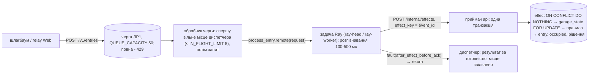

# DPC ЛР3. Розподілена обробка в Ray і відновлення: докладно

Скорочений опис і таблиця пунктів - [README.md](../../README.md), розділ 6. Тут - механізм, повні результати дослідів і межі гарантій.

## Схема



`EXECUTION=ray` - типовий режим (`compose.yaml`, `.env.example`); `EXECUTION=local` лишає пул ЛР1 для порівняння
(обробник сам виконує ту саму транзакцію). Правило допуску й зміна ресурсу - одна функція `entries.admit`, її
викликають обидва режими; приймач додає лише ключ і збережене рішення.

## Механізм

**Хто змінює ресурс.** Задача Ray (`dpc/api/app/raytasks.py`) не має з'єднання з базою: вона розпізнає номер і
передає результат приймачу `POST /internal/effects` того самого api (той самий Bearer-токен; маршрут не входить у
`openapi.yaml` і не публікується через nginx - api взагалі не за nginx). Приймач в одній транзакції:
`INSERT INTO effect (effect_key, request_id, decision) … ON CONFLICT (effect_key) DO NOTHING RETURNING`; якщо рядок
вставлено - `SELECT … FROM garage_state … FOR UPDATE`, правило ЛР1, `INSERT entry` (лише якщо дозволено),
`UPDATE garage_state`, `entry_request` у `done`/`rejected`, для відмови - `effect.decision = 'rejected'` і причина.
Якщо ключ уже є - повертається збережене рішення, ресурс не змінюється (`repeated: true`). Відмови теж зберігаються:
повтор отримує те саме `rejected` з тією самою причиною, навіть якщо місце тим часом звільнилось. Дві одночасні
доставки того самого ключа: друга чекає на унікальному індексі, доки перша не зафіксується, і отримує її рішення.

**Повтор після відмови.** `@ray.remote(max_retries=3, num_cpus=0.25)`: Ray повторює задачу після системної відмови
(процес-виконавець завершився, вузол втрачено); винятки коду задачі не повторюються (`retry_exceptions` типово
вимкнено), запит тоді стає `failed` / `task-failed`, якщо приймач ефекту не записав. Ключ ефекту - `event_id`
запиту; він приходить в аргументі задачі, тож однаковий у всіх спробах. Розпізнавання засіяне `event_id`: повторна
спроба чекає той самий час і «розпізнає» той самий номер. Недоступний приймач (5xx, мережа) задача повторює сама
з тим самим ключем, до 20 разів з паузою 0.2-2 с.

**Диспетчер і обмеження.** У режимі `ray` кожен із `WORKERS` обробників черги спершу бере місце семафора
`IN_FLIGHT_LIMIT`, потім запит із черги, і подає задачу (`process_entry.remote` у потоці, щоб не блокувати цикл
подій). Поки 8 задач не завершено, жоден обробник не бере запит - решта чекає в черзі ЛР1, і повна черга відповідає
429. На кожну подану задачу - одна корутина `await asyncio.wrap_future(ref.future())`: результат обробляється, щойно
готова саме ця задача, незалежно від порядку подання (типова помилка «чекати в порядку подання» неможлива). Корутина
звільняє місце й закриває запит у пам'яті; стан у базі вже записав приймач. `ray.init(address=RAY_ADDRESS)`
виконується в потоці з повтором кожні 2 с, тому api відповідає на `/health`, навіть поки `ray-head` стартує.

**Метрики.** `/metrics`: `in_flight` - незавершені задачі Ray (у `local` - запити в обробниках), `in_flight_max`,
`in_flight_limit`, `execution`, `effects_accepted`, `effects_repeated`. `GET /v1/garage/{id}` повертає `execution`,
картка стану паркінгу клієнта показує рядок Execution.

**Журнали.** Процеси-виконавці Ray пишуть у файли Ray; рядки `jsonlog` задачі дублюються у вивід PID 1 контейнера
(`/proc/1/fd/1`), тож `docker compose logs ray-head ray-worker` показує `fault.hit` і `task.done`. Пересилання
журналів у драйвер вимкнено (`log_to_driver=False`), щоб журнал api не містив рядків задач.

**Оновлення коду задач.** Код задачі імпортують процеси `ray-head` і `ray-worker` з того самого образу. Після будь-якої
зміни `dpc/api/app`: `docker compose up -d --build api ray-head ray-worker`.

## Перевірки

```bash
docker compose up -d api ray-head ray-worker
uv run --no-project --python 3.13 --with pytest --with httpx --with "psycopg[binary]" --with numpy pytest dpc/api/tests -v
```

| Перевірка | Результат |
|---|---|
| `pytest dpc/api/tests`, `EXECUTION=ray` | 42 passed, 2 skipped (`pytest.txt`) |
| `pytest test_lr1.py test_lr3.py`, `EXECUTION=local` | 19 passed (`pytest-local.txt`) - правило ЛР1 і приймач однакові в обох режимах |
| `pytest web/server/tests` (регрес) | 52 passed (`pytest-web.txt`) |
| `npx @redocly/cli lint dpc/openapi.yaml` | valid, 5 давніх попереджень (`openapi-lint.txt`) |
| `docker compose config --quiet`; `tsc -b`, `eslint`, `npm run build` клієнта | без помилок (`compose-config.txt`, `client-build.txt`) |

Нові тести `test_lr3.py`: повтор доставки повертає збережене `accepted` (3 повтори, 1 в'їзд, `occupied` 1);
`rejected`/`full` зберігається й повертається навіть після звільнення місця; 8 одночасних доставок - один ефект;
приймач дає ті самі рішення, що й тести ЛР1 (`full`, в'їзд за бронюванням при вичерпаній квоті, `already-inside`,
`not-inside`); 409 на чужий ключ, 404 на невідомий запит, 401 без токена; запит через стенд і повтор його ефекту.

## Досліди

Середовище - як у ЛР1 (`results/dpc-lr1/machine.txt`): Windows 11, i5-13420H, Docker Desktop, ВМ WSL2 з 4 CPU.
Кластер Ray: `ray-head` (1 CPU) і два `ray-worker` (по 2 CPU), задача займає 0.25 CPU - 20 місць. Сценарії з кореня:

```bash
uv run --no-project --python 3.13 --with httpx --with aiohttp --with "psycopg[binary]" python experiments/dpc_lr3.py fault | tee results/dpc-lr3/fault.txt
uv run --no-project --python 3.13 --with httpx --with aiohttp --with "psycopg[binary]" python experiments/dpc_lr3.py compare | tee results/dpc-lr3/compare.txt
uv run --no-project --python 3.13 --with httpx --with aiohttp --with "psycopg[binary]" python experiments/dpc_lr3.py inflight | tee results/dpc-lr3/inflight.txt
```

### О3.4. Відмова після запису ефекту (`fault.txt`)

Тестовий паркінг `dpc-race` (5 місць) скинуто; `docker compose exec api touch /faults/after_effect_before_ack`;
один в'їзд. Прапорець бачать усі вузли (том `faults` у `x-api`, спільний для `api`, `ray-head`, `ray-worker`).
Очікування: процес-виконавець завершується після відповіді приймача, Ray повторює задачу з тим самим `event_id`,
приймач повертає збережене рішення, ресурс змінено один раз.

| Випадок | Журнал | Ray State API | SQL | `GET /v1/garage/dpc-race` |
|---|---|---|---|---|
| прийнятий в'їзд (паркінг порожній) | `effect.accepted` → `fault.hit` (ray-head) → `effect.repeated` → `task.done repeated: true` | спроба 0 `FAILED WORKER_DIED`, спроба 1 `FINISHED` | `effect` 1 рядок `accepted`, `entry` 1, `occupied` 0 → 1 | 1 / 1, `invariant_ok: true`; запит `done` |
| відхилений в'їзд (паркінг 5 з 5) | ті самі рядки, `decision: rejected` | спроба 0 `FAILED`, спроба 1 `FINISHED` | `effect` 1 рядок `rejected`/`full`, `entry` 0, `occupied` 5 → 5 | 5 / 5, `invariant_ok: true`; запит `rejected full` |

Прапорець забрано один раз (файлу після досліду немає), повторна спроба працювала звичайно. Відновлення: нічого
робити не треба - Ray сам запускає новий процес-виконавець; ще не спрацьований прапорець прибирає
`docker compose exec api rm -f /faults/after_effect_before_ack`. Рисунок Ray Dashboard - `docs/reports/img/dpc-lr3-ray.png`.

### Local проти ray на тому самому навантаженні (`compare.txt`)

`dpc-race`, 40 авто їздять туди й назад до 200 запитів (сценарій О1.4), `WORKERS=8` (у `ray` ще й
`IN_FLIGHT_LIMIT=8`), `locked`; перед вимірюванням - розігрів 40 запитами в обох режимах.

| Режим | Час, с | `occupied` / `inside` | `invariant_ok` | рядків `effect` | повне виконання p50 / p95, мс | оброблення p50, мс | очікування в черзі p95, мс |
|---|---|---|---|---|---|---|---|
| local | 8.7 | 5 / 5 | true | 0 | 1547.4 / 1814.2 | 330.4 | 1416.0 |
| ray | 9.4 | 5 / 5 | true | 200 | 1743.8 / 2066.7 | 351.5 | 1616.9 |

Стани однакові: 25 в'їздів, 20 виїздів, 155 відмов `full`. Це водночас регрес О1.4 у режимі `ray`: інваріант
зберігся. Ray додає близько 21 мс на запит (подання задачі, HTTP до приймача); за однакової паралельності 8 це
зменшує пропускну здатність на 7 % (23.0 → 21.3 запиту/с) і подовжує очікування в черзі. Перший прогін без розігріву дав p99 оброблення
3.8 с: новий процес api - нове завдання (job) Ray, і процеси-виконавці для нього стартують на вимогу (1-3 с кожен);
звідси розігрів. Ще один знайдений вплив: `httpx.post` на кожну доставку створював новий клієнт (~60 мс на задачу,
задача p50 392 → 359 мс після одного клієнта на процес; PC-20).

### О3.2. Обмеження незавершених задач (`inflight.txt`)

`EXECUTION=ray`, `IN_FLIGHT_LIMIT=8`, `WORKERS=4`, `QUEUE_CAPACITY=50`; 60 клієнтів без пауз 30 с на `dpc-race`
(як О1.2); `/metrics` кожні 0.5 с, `/health` 10/с, незавершені задачі `process_entry` у Ray State API кожні 2 с.
Затримка приймача `RECEIVER_DELAY_MS` - 0 і 500 мс, інше однакове. Прогноз: `in_flight` не перевищує 8 за будь-якої
затримки; повільніший приймач зменшує пропускну здатність приблизно вдвічі, черга заповнена, надлишок отримує 429.

| Затримка, мс | POST | 202 | 429, % | пропускна здатність, запитів/с | повне виконання p50 / p95, мс | max `in_flight` | черга max / середня | max незавершених задач у Ray | `/health` p95, мс | `invariant_ok` |
|---|---|---|---|---|---|---|---|---|---|---|
| 0 | 43243 | 603 | 98.6 | 18.65 | 3004.0 / 3393.2 | 8 | 50 / 46.1 | 8 | 46.7 | true |
| 500 | 50969 | 319 | 99.4 | 8.80 | 6278.4 / 6804.9 | 8 | 50 / 48.5 | 8 | 35.6 | true |

Сповільнення приймача збільшує час задачі (оброблення p50 403 → 854 мс), але кількість незавершених задач у Ray
лишається 6-8 у кожному замірі (не росте без меж): нові задачі не подаються, доки не звільниться місце. Надлишок
залишається в черзі ЛР1 (середня довжина 46-49 з 50), а понад неї - 429. Зворотний тиск передається ланцюжком
«приймач → задача → місце диспетчера → черга → 429 клієнту». Після зупинки навантаження черга дооброблялась
4.1 с і 5.9 с. Повторний прогін із затримкою 500 мс для рисунка Grafana (`inflight-grafana.txt`): 9.03 запиту/с,
p95 6509.5 мс, max `in_flight` 8. Рисунок - `docs/reports/img/dpc-lr3-grafana.png`.

### Наскрізний шлях Web ЛР4 у режимі ray (`web-e2e-ray.txt`)

`experiments/web_lr4.py e2e` при `EXECUTION=ray`: бронювання → операція `succeeded` → relay → запит DPC `done` →
бронювання `entered`; `effect` 1, `entry` 1; повтор того самого `event_id` двічі - той самий запит
(`Repeated-Request: true`), рядків `entry_request` 1, `entry` 1.

## Межі гарантій

- Один ефект на ключ гарантує унікальний `effect_key` у тій самій транзакції, що й зміна ресурсу. Перевірено відмову
  процесу-виконавця Ray після запису ефекту (О3.4) і одночасні повтори доставки (тест).
- Відмову самого `api` під час транзакції приймача чи з незавершеними задачами не досліджували. Черга й місця
  диспетчера в пам'яті api: після аварії api запити `queued`/`processing` позначаються `failed` / `lost-on-restart`,
  але задача Ray, подана до аварії, може ще доставити ефект - тоді приймач запише в'їзд і змінить стан запиту на
  `done` (ресурс і інваріант при цьому узгоджені).
- Втрату вузла Ray цілком (`docker compose kill ray-worker`) не досліджували; `max_retries=3` її покриває лише поки
  є живі вузли. Відмова `ray-head` розриває з'єднання клієнта Ray, api тоді не подає задач до перезапуску.
- Ідемпотентність HTTP API (Д3.3) не робили: повтор `POST /v1/entries` з тим самим `event_id` повертає той самий
  запит за правилом ЛР1, але `Idempotency-Key` не підтримується.
- Д3.1, Д3.2, Д3.4 не виконувались (дослід із двома затримками приймача зроблено в межах О3.2).
