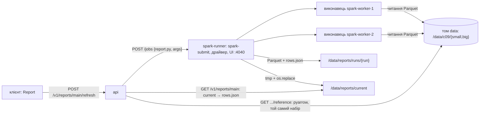

# DPC ЛР4. Пакетний звіт у Spark: докладно

Скорочений опис і таблиця пунктів - [README.md](../../README.md), розділ 6. Тут - механізм, повні результати дослідів
і межі гарантій. Стенд дослідів: `postgres api spark-master spark-worker-1 spark-worker-2 spark-runner` (PC-28),
2 виконавці по 2 ядра й 1 ГБ, ВМ Docker з 4 логічними CPU.

## Схема

## Дані (О4.1)

Генератор комплекту (`dpc/tools/generator/generate_history.py`) з описом `spec.c09.json` і функціями `columns.c09.py`.
Довідник `garages(garage_id, name, city, tariff_minor_per_hour)` - 10 паркінгів, перший - гарячий ключ `mall`
(торговий центр), тарифи `mall` 3000 і `center` 4000 коп./год як у демоданих. Факти `history(session_id, garage_id,
plate, entered, minutes, amount_minor)`: `garage_id` - посилання на довідник з часткою `mall` 0.45, `entered` - момент
UTC за 300 днів 2026 р. з денними годинами, `minutes` - лог-нормальний розподіл (медіана 90, 10-600),
`amount_minor = ceil(minutes / 60) × тариф`. Тариф довідника й тариф у функції суми беруться з одного словника
`GARAGES`, тому звіт і еталон не можуть розійтися з даними.

| Набір | Команда | Рядків | Розмір фактів | Частин | seed | `mall` | Частка |
|---|---|---|---|---|---|---|---|
| small | `docker compose run --rm generator` | 100 000 | 2.7 МБ | 1 | 909 | 44 710 | 0.4471 |
| big | `docker compose run --rm generator --out /data/c09/big --rows 10000000 --jobs 4` | 10 000 000 | 251.9 МБ (253 МБ за `du`) | 49 | 909 | 4 501 837 | 0.4502 |

Відтворюваність: та сама команда в `/data/c09/small-repro` дала побайтно ті самі файли (SHA-256 усіх Parquet
`909c71a24356144f…` в обох). Генерація small - 18 с, big - 8 хв 39 с (`datasets.txt`, `generate-big.txt`).

## Задача (О4.2)

`dpc/spark/jobs/report.py`: `history.select(garage_id, minutes, amount_minor)` → `join(garages.select(garage_id, name))`
→ `groupBy(garage_id, name)`: `sessions = count`, `total_minutes = sum(minutes)`, `revenue_minor = sum(amount_minor)`
(усе `bigint`), `avg_minutes = total_minutes / sessions` (одне ділення цілих сум, не середнє середніх). На драйвер
збираються лише 10 агрегованих рядків. Довідник малий, тому типово Spark розсилає його (BroadcastHashJoin) і факти
не перетасовуються: `HashAggregate` partial → `Exchange hashpartitioning(garage_id, name)` → `HashAggregate` final
(`plan-auto-broadcast.txt`).

Маршрути api (`dpc/api/app/reports.py`): `POST /v1/reports/main/refresh` → `POST http://spark-runner:8000/jobs`
→ 202 `{job: {run, state}}`; запускач тримає одну задачу на скрипт, повторний запуск - 409 `report-running` (Problem
Details, поле `run`). `GET /v1/reports/main` → `{job, published, rows}`: `job` - найновіша задача запускача,
`published`/`rows` - запуск із вказівника. На малому наборі задача триває 28 с (з них ≈ 15 с - старт Spark).

## Еталон (О4.3)

`dpc/api/app/reference.py`: `pyarrow.dataset` порціями по 262 144 рядки, кожен рядок додається до словника
`garage_id → [кількість, сума хвилин, сума копійок]` у цілих Python, середнє - сума / кількість, назви - з довідника.
Набір - той, на який указує `current`. Порівняння `compare()` за ключем `garage_id`: цілі й рядки - те саме значення
того самого типу, `avg_minutes` - у межах 1e-9. Еталон рахує 10⁵ рядків за 0.12-0.74 с, 10⁷ - за 6.8 с.

| Перевірка | Результат |
|---|---|
| `test_lr4.py` (5): еталон на фіксованих 7 рядках у двох частинах, порції по 2 рядки, порівняння за ключами, refresh → 409 → звіт = еталон, валідація | 5 passed (`pytest.txt`) |
| `dpc_lr4_compare.py --refresh --dataset small` | 10 рядків, 0 розбіжностей, MATCH (`compare-small.txt`) |
| Звіт на big (6 запусків О4.4, О4.5) | 0 розбіжностей у кожному |

## План і перекіс (О4.4)

Режим `--join shuffle`: `spark.sql.autoBroadcastJoinThreshold = -1` і те саме для AQE, тож план - SortMergeJoin.
Очікування записано до запусків: `skew-expectation.md`.

Базовий план (`plan-shuffle-aqe-off.txt`): обидві сторони - `Exchange hashpartitioning(garage_id, 200)` +
`Sort` → `SortMergeJoin` → `HashAggregate` partial і final без власного Exchange (розподіл за `garage_id` уже
задовольняє групування за `(garage_id, name)`). Часткової агрегації до перетасування фактів немає: з'єднання стоїть
перед групуванням, тож перетасовуються всі 10⁷ рядків (400 МБ за статистикою плану, 54 МБ стиснутих). Усі рядки
`mall` потрапляють в одну частину з 200; непорожніх частин 10.

Варіант AQE (`plan-shuffle-aqe-skew.txt`): `skewJoin` з порогами `skewedPartitionThresholdInBytes` 8 МБ,
`skewedPartitionFactor` 3, `advisoryPartitionSizeInBytes` 4 МБ і `forceOptimizeSkewedJoin` (PC-27).
`AQEShuffleRead coalesced and skewed` ділить частину `mall` на 4, рядок довідника повторюється для кожної;
`SortMergeJoin(skew=true)`. Поділ ламає розподіл за ключем, тому після з'єднання з'являється часткове агрегування
(`partial_count`, `partial_sum`) → `Exchange hashpartitioning(garage_id, name)` (13 рядків, 1 КБ) → остаточне.

| Варіант (медіана 3) | Задача, с | Стадія з'єднання, с | Задач | Найдовша, мс | Медіана непорожніх, мс | max / med | Shuffle read, max / медіана, МБ | = еталон |
|---|---|---|---|---|---|---|---|---|
| `SPARK_AQE=off` | 37.5 | 17.9 | 200 (10 непорожніх) | 13 504 | 2 646 | 5.1 | 23.0 / 3.2 | 3/3 |
| AQE `skewJoin` | 27.2 | 8.3 | 13 | 5 034 | 1 607 | 3.1 | 6.0 / 3.2 | 3/3 |

Окремі запуски (`skew.txt`, `skew.json`): off - 53.0 / 37.5 / 31.5 с, стадія 29.5 / 17.9 / 13.3 с, найдовша задача
24.0 / 13.5 / 9.3 с; skew - 27.8 / 25.1 / 27.2 с, стадія 8.9 / 8.3 / 5.6 с, найдовша 5.7 / 5.0 / 2.8 с. Стадія читання
Parquet (5 задач) в обох варіантах та сама: найдовша задача 8.2 / 8.3 с.

Висновок. Перекіс є: одна задача читає 4.5·10⁶ рядків (45 %), у 5 разів довша за медіану, три інші ядра чекають.
AQE поділив її на 4 частини по 6 МБ: стадія з'єднання скоротилась у 2.2 раза, уся задача - на 10 с. Очікування
справдились частково: стадія 8.3 с (очікували 8-9), але частин 4, а не 6, і найдовша задача 5.0 с, а не ≈ 3 с -
межі поділу задають 5 блоків виходу стадії читання. Залишкове max/med 3.1: частини `mall` усе ще більші за решту.
Знімки стадій - `docs/reports/img/dpc-lr4-stage-*.png` (сервер історії Spark).

## Втрата виконавця (О4.5)

`experiments/dpc_lr4.py executor`: `POST /v1/reports/main/refresh {dataset: big, join: shuffle}` (AQE типово
увімкнено), коли обидва виконавці виконують задачі - `docker compose kill spark-worker-1` (`executor.txt`):

- t+38.3 с виконавці 0 (spark-worker-1, 172.20.0.3) і 1 (spark-worker-2, 172.20.0.21) мають задачі; t+41.3 с - kill;
- журнал подій: `executor removed 0: worker lost: 172.20.0.3:37549 got disassociated`, 2 задачі стадії 3 (читання
  Parquet) - `ExecutorLostFailure` на виконавці 0; Spark повторив їх на виконавці 1;
- t+72.7 с задача `done` (71.8 с у запускачі), опубліковано новий запуск, звіт = еталон (0 розбіжностей);
- відновлення: `docker compose up -d spark-worker-1`.

Знімок таблиці виконавців (виконавець 0 Dead, 2 невдалі задачі): `docs/reports/img/dpc-lr4-executor.png`.
Перша спроба досліду завершилась так само (`done` через 22 с після kill), але сценарій не прочитав стиснутий журнал
подій (PC-26); повторено повністю.

## Атомарна публікація (Д4.3)

Запуск пише лише свій каталог `/data/reports/runs/{run}` (`mode("error")`), потім новий вказівник у
`/data/reports/.current.{run}.tmp`, `fsync`, `os.replace` на `/data/reports/current`. `experiments/dpc_lr4.py atomic`
(`atomic.txt`): запуск із `--facts /data/c09/missing/history` - `failed`, exit 1, `PATH_NOT_FOUND`; каталогу запуску
немає, `current` побайтно той самий (inode 596132), `GET /v1/reports/main` - `job.state failed`, `published` -
попередній запуск. Наступний успішний запуск - новий файл (inode 596223) на місці старого, тимчасових файлів немає.

## Межі гарантій

- Звіт = еталон перевірено на двох наборах; еталон читає ті самі файли, тож помилку генератора він не виявить.
- Атомарний лише перехід вказівника; читач, що прочитав `current` до заміни, дочитує старий `rows.json` (каталоги
  запусків не видаляються, прибирання старих запусків не реалізовано).
- Відмова драйвера (`spark-runner`) не досліджувалась: задача втрачається, `current` не змінюється, запуск треба
  повторити вручну; стан задачі запускач тримає в пам'яті.
- О4.5: втрачено виконавця під час стадії читання; повторне обчислення вже записаних блоків перетасування (втрата
  виконавця після стадії) не перевірялось окремо.
- Час дослідів залежить від фонового навантаження ВМ (PC-28): числа - медіани 3 запусків на зупиненому решті стенда.
