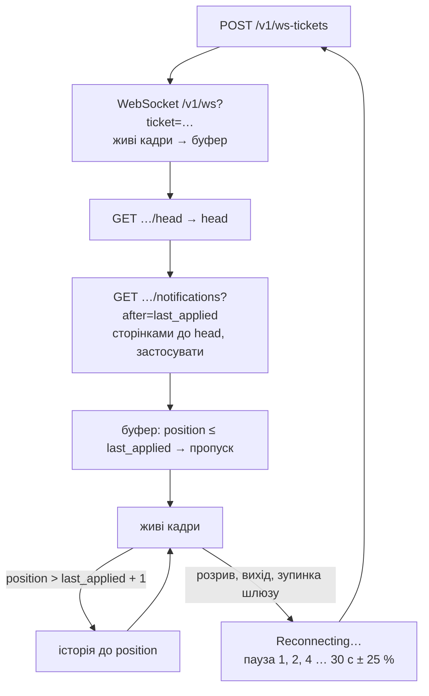

# Web ЛР5. Сповіщення через WebSocket: докладно

Скорочений опис і таблиця пунктів - [README.md](../../README.md), розділ 6. Тут - механізм, повні результати
дослідів і межі гарантій.

## Шлях сповіщення

```mermaid
sequenceDiagram
    participant A as app-a / app-b / worker
    participant DB as PostgreSQL
    participant P as publisher
    participant K as Kafka notifications
    participant GA as gateway-a (група gateway-a)
    participant GB as gateway-b (група gateway-b)
    participant C1 as вкладка 1 (на gateway-a)
    participant C2 as вкладка 2 (на gateway-b)
    A->>DB: BEGIN; причина (бронювання / результат операції / перевірка 15 хв)
    A->>DB: notification_seq FOR UPDATE; position + 1; INSERT notification; outbox notification.created; COMMIT
    P->>DB: SELECT ... FOR UPDATE SKIP LOCKED
    P->>K: send (key = user id, acks=all); published_at; COMMIT
    K->>GA: notification.created
    K->>GB: notification.created
    GA->>C1: {id, position, type, text, created_at}
    GB->>C2: той самий кадр
    Note over GA,GB: кожен шлюз шле лише своїм з'єднанням цього користувача
```

Причини:

| Тип | Текст у клієнті | Де записується | Джерело (`source_event_id`) |
|---|---|---|---|
| `booking.confirmed` | «Spot confirmed: City Centre, Level 1, 25.11 08:00, 1 h, AA1234KB» (Місце підтверджено) | транзакція `POST /v1/bookings` | id бронювання |
| `entry.opened` / `entry.failed` | «Barrier opened» / «Barrier not opened: …» (Шлагбаум відкрито, ЛР4) | транзакція результату worker | id події `entry.requested` |
| `booking.ending` | «Booking ends at 18.11 12:00: …» (Бронювання закінчується за 15 хвилин) | worker, раз на 60 с: `confirmed`, кінець за ≤ 15 хв | id бронювання + `:ending` |

«Місце звільнилося (підписаним)» не зроблено: підписок на рівень у системі немає (не входять у ядро), а
сповіщення без підписки пішло б усім користувачам.

## Механізм

**Квиток і підключення (О5.1).** Браузер не може передати `Authorization` у рукостисканні WebSocket, а токен
сесії не можна класти в URL (журнали nginx, історія). Тому клієнт обмінює сесію на квиток: `POST /v1/ws-tickets`
(лише з входом) → 201 `{ticket, expires_in: 30, expires_at}`, `Cache-Control: no-store`. Квиток - 32 випадкові
байти; у `ws_ticket` (міграція 009) лише його sha256, користувач, sha256 токена сесії і `expires_at = now() + 30 с`.
Шлюз до `accept()` перевіряє `Origin` (рівно `CLIENT_ORIGIN`, `http://localhost:5173`) і погашає квиток одним
оператором:

```sql
UPDATE ws_ticket t SET used_at = now()
FROM session s
WHERE t.ticket_hash = $1 AND t.used_at IS NULL AND t.expires_at > now()
  AND s.token_hash = t.session_token_hash AND s.expires_at > now()
RETURNING t.user_id, t.session_token_hash, s.expires_at
```

Два підключення з тим самим квитком (навіть на різні шлюзи) змагаються за той самий рядок: `UPDATE` другого
бачить `used_at` і нічого не повертає. Будь-яка відмова → `close(1008)` до прийняття, і uvicorn відповідає на
рукостискання HTTP 403 (PC-22). Користувач береться лише з квитка.

**Сесія і з'єднання.** З'єднання належить сесії, для якої видано квиток. Вихід (`POST /v1/auth/logout`) в одній
транзакції видаляє сесію і пише в outbox `session.revoked {user_id, session_token_hash}` (тема `notifications`).
Кожен шлюз закриває з'єднання цієї сесії кодом 1008 і пам'ятає відкликання 10 хв (на випадок, якщо повідомлення
прийшло між погашенням квитка і реєстрацією з'єднання, PC-24); квиток, узятий до виходу, після виходу не
погашається, бо сесії вже немає. Інші сесії того самого користувача (інша вкладка після окремого входу, інший
пристрій) лишаються відкритими. На кінець строку сесії шлюз ставить таймер закриття 1008.

**Два шлюзи (О5.2).** Кожен шлюз читає тему `notifications` своєю групою (`GROUP_ID` = `gateway-a` / `gateway-b`),
тому отримує кожне повідомлення. У пам'яті шлюзу - `user → {з'єднання}` і `session → {з'єднання}`; кадр
`{id, position, type, text, created_at}` іде лише з'єднанням цього користувача на цьому шлюзі. Перший кадр -
`{"type": "hello", "gateway": "gateway-a"}`. Кадр, не прийнятий за 5 с, закриває з'єднання (клієнт відновиться
з історії). Реєстру «користувач → шлюз» немає (Д5.1 не вибрано): кожен шлюз читає всі повідомлення.

**Стрічка і відновлення (О5.3).** `GET /v1/me/notifications?after=<позиція>&limit=` → власні сповіщення з
`position > after` за зростанням і `next_after`; `after`, що не є числом → 400. `GET /v1/me/notifications/head` →
`{position}` = `notification_seq.last_position` (0, якщо немає). Позиція береться з лічильника користувача під
`FOR UPDATE` у транзакції вставки (ЛР4), тому друга транзакція того самого користувача чекає, доки перша
зафіксується, і позиції йдуть 1, 2, 3 … у порядку комітів без пропусків. Отже, усе до `head` уже зафіксовано,
і запис, зафіксований пізніше, отримає позицію, більшу за `head`, - його не пропустить читання «після
`last_applied`». Час `created_at` для курсора не годиться: це початок транзакції, і в досліді 50 паралельних
15 пар мали більшу позицію з ранішим `created_at`.

Алгоритм клієнта (браузер `web/client/src/feed.ts`, скрипт `experiments/feed_client.py`):



`last_applied` і останні 30 сповіщень зберігаються в `sessionStorage` (ключ `notifications:<id користувача>`),
тож перезавантаження вкладки продовжує з того самого місця; нова вкладка починає з `head - 20`.
Кадр, що прийшов між підпискою і читанням `head`, лежить у буфері; він або вже є в історії (і тоді
пропускається), або має позицію `head + 1` і застосовується після історії - у жодному разі не двічі й не губиться.

**Клієнт (О5.4).** Дзвіночок у шапці з лічильником непрочитаних, стан з'єднання (Live / Reconnecting… / Connecting…,
у списку - ще й назва шлюзу), список останніх 30 сповіщень із позицією й часом, тост на кожне нове (і на пропущені,
дочитані після відновлення). Вихід зупиняє стрічку; спроба нового квитка після виходу дає 401 і повертає на вхід.

**nginx.** `location = /v1/ws` проксіює на `gateway-a`, `gateway-b` (`least_conn`); `?ticket=` і `Origin` проходять
без змін; `proxy_connect_timeout 2s` (PC-23), щоб зупинений шлюз пропускався за 2 с, а не 60. Тихе з'єднання не
закривається через `proxy_read_timeout 60s`: uvicorn надсилає ping кожні 20 с (`idle.txt`).

## Досліди

Стенд `docker compose up -d nginx publisher worker relay external-sim gateway-a gateway-b` (+ `api` для `e2e`).
Кожен запуск робить власних користувачів і власний паркінг `t5-xxxx` (рівень на 200 місць, тариф видаляється
наприкінці).

```bash
uv run --no-project --python 3.13 --with httpx --with "psycopg[binary]" --with websockets python experiments/web_lr5.py auth | tee results/web-lr5/auth.txt
```

(аналогічно `two`, `window`, `gateway`, `parallel`, `e2e`, `ending`; тихе з'єднання - `experiments/web_lr5_idle.py`).

| Дослід | Що зроблено | Результат |
|---|---|---|
| Квиток і Origin (`auth`) | квиток без входу; квиток; те саме підключення двічі (і на gateway-b); чужий Origin, без Origin; без квитка, вигаданий; прострочений (чекали 31 с) | без входу 401; 201, квиток 43 символи, `no-store`, у базі лише хеш; перше підключення - `hello` від gateway-a; повтор (обидва шлюзи), `Origin: http://localhost:8082`, без Origin, без квитка, вигаданий, прострочений → 403 на рукостискання; квиток, відхилений через Origin, не витрачено (потім відкрився) |
| Вихід (`auth`) | користувач із двома входами; сесія 1 - на gateway-a і gateway-b, сесія 2 - через nginx; `POST /v1/auth/logout` сесії 1 | 204; обидва з'єднання сесії 1 закрито кодом 1008 (≤ 10 мс після відповіді); `ws.session_revoked closed: 1` на кожному шлюзі; квиток сесії 1, узятий до виходу → 403; новий квиток → 401; з'єднання сесії 2 відкрите й отримало наступне сповіщення |
| Два шлюзи (`two`) | користувач U: клієнт напряму на :8091 і на :8092; користувач B через nginx; 2 бронювання U | обидва клієнти U отримали ті самі `(id, position)` = (c2439e17, 1), (ba000efe, 2) за ~80 мс після 201; B - нічого; у журналі `ws.delivered connections: 1` на gateway-a і на gateway-b для кожного |
| Між підпискою і head (`window`) | клієнт підписався, бронювання в паузі 3 с, потім head | кадр позиції 1 у буфері; `head = 1`; застосовано з історії, живу копію пропущено; застосувань 1 |
| Зупинка шлюзу (`gateway`) | клієнт на gateway-a (:8091), 1 сповіщення; `docker compose stop gateway-a`; 3 бронювання; клієнт - через nginx | закрито кодом 1012 (зупинка uvicorn); 3 бронювання, `head` 4; через 2.5 с підключено через nginx до gateway-b, `head = 4`, позиції 2, 3, 4 з історії; позиції 1-4 по одному разу, дублів 0; `docker compose start gateway-a` |
| 50 паралельних (`parallel`) | 50 одночасних бронювань одного користувача (старт кожного - випадково в межах 3 с); клієнт рве з'єднання випадково (таймер 0.2-0.8 с і 15 % після кадру) | 50 × 201 за 3.0 с; позиції 1..50 без пропусків; 15 пар із більшою позицією й ранішим `created_at`; клієнт: 5 сесій на обох шлюзах, 50 застосовано по порядку, кожен id рівно раз, 48 з історії, 2 наживо, 8 живих дублів пропущено |
| Наскрізний шлях ЛР4 (`e2e`) | бронювання поточної години, `POST …/entries` | наживо: 1 «Spot confirmed», 2 «Booking ends at 12:00» (перевірка worker спрацювала сама о 11:49), 3 «Barrier opened» через 3.1 с після 202; операція `succeeded` |
| 15 хвилин (`ending`) | бронювання поточної години; 2 раунди перевірки з вікном 60 хв | перший раунд додав `booking.ending` (позиція 2), другий - 0 |
| Тихе з'єднання (`web_lr5_idle.py`) | з'єднання через nginx без сповіщень 75 с | після 76 с відкрите, ping клієнта отримав відповідь (`proxy_read_timeout 60s` не спрацював) |

Тести: `web/server/tests/test_lr5.py` - 7 тестів (одноразовий квиток на обох шлюзах; прострочений, чужий Origin,
без квитка; доставка двома шлюзами лише користувачу; вихід → 1008 лише для сесії; стрічка й head, 400, 401;
20 паралельних → позиції 1..20 і 20 повідомлень в outbox; «15 хвилин» один раз). Разом із ЛР1-ЛР4 - 59 passed.

## Керована відмова й межі гарантій

| Відмова | Команда | Що видно | Відновлення |
|---|---|---|---|
| Зупинка шлюзу (картка C09) | `docker compose stop gateway-a` | клієнти gateway-a отримують закриття 1012, у клієнті «Reconnecting…»; сповіщення далі пишуться в стрічку | клієнт бере новий квиток, nginx веде на gateway-b, клієнт дочитує історію від `last_applied`; `docker compose start gateway-a` - шлюз дочитує тему від свого offset (старі кадри новим з'єднанням клієнт відкидає за позицією) |

Що підтверджено й що ні:

- Жодне сповіщення не губиться для клієнта: живий канал - лише прискорення, правда - у стрічці з позиціями
  без пропусків. Перевірено зупинкою шлюзу, випадковими розривами (50 паралельних) і вікном між підпискою і `head`.
- Застосування рівно один раз - на боці клієнта (за позицією); шлюзи можуть надіслати той самий кадр двічі
  (повторна публікація outbox, дочитування теми після перезапуску) - клієнт його пропускає.
- Історія зберігається безстроково (рядки `notification` не видаляються); застарілого курсора й 410 немає (Д5.8 не робили).
- Обидва шлюзи читають усю тему: кожне повідомлення обробляє кожен шлюз, навіть якщо в нього немає з'єднань
  цього користувача (Д5.1 не робили). Розподіл 100 з'єднань і пам'ять (Д5.4), контроль з'єднання (Д5.5),
  повільний клієнт (Д5.6) не досліджували.
- Браузер не бачить коду відмови рукостискання (403 для нього - закриття 1006): клієнт просто бере новий квиток із
  паузою, що зростає; після виходу квиток дає 401 - і клієнт іде на вхід.
- Квиток у URL: він живе 30 с і погашається першим підключенням, але може потрапити в журнал доступу nginx
  (у нашому форматі журналу є лише `$uri` без рядка запиту).
